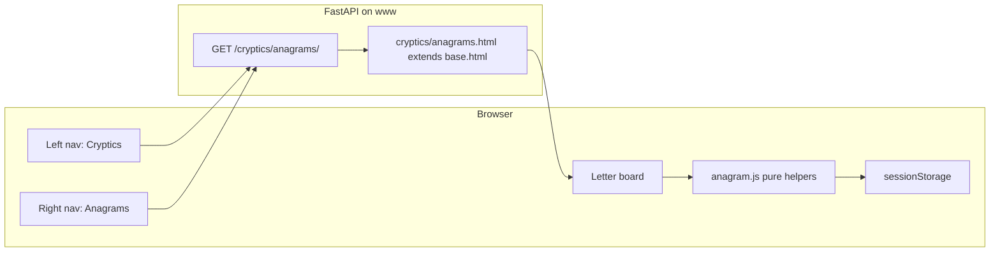
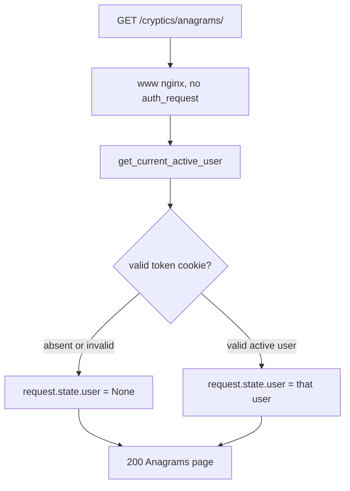
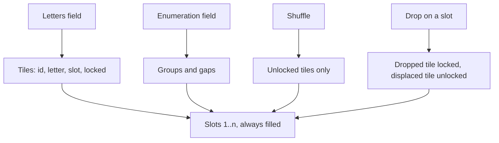
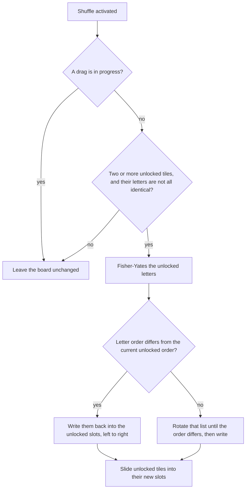
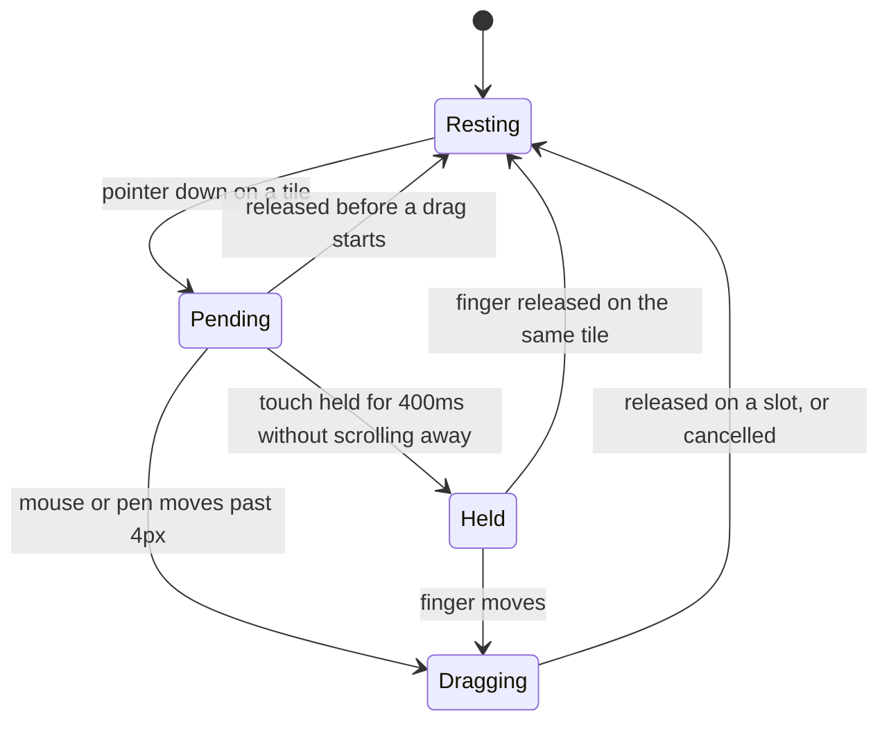
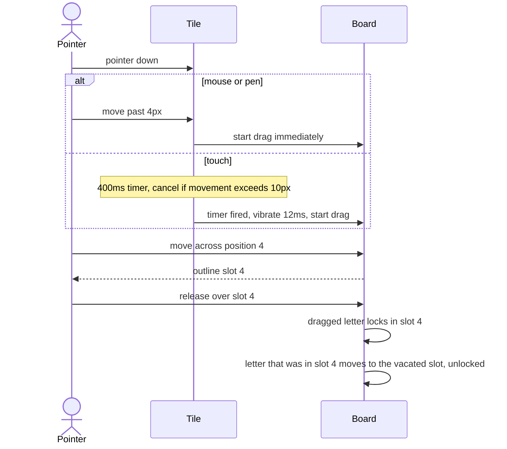

# Design: Cryptics

Status: Proposed  
Date: 2026-10-25  
Scope: Public crossword tools on the main site. Version 1 is the Anagram helper.

## 1. Goal

Add a public **Cryptics** section for solving cryptic crosswords. Anyone can open it. No account, no privilege flag, and no nginx login gate.

Version 1 ships one tool, the **Anagram helper**:

- Type or paste the fodder letters.
- Shuffle them into a new order.
- Drag a letter onto a numbered position to lock it there. Further shuffles move only the unlocked letters.

Later tools (pattern search, hidden words, and so on) should be able to appear as further right-nav entries without a new section.

Non-goals for v1:

- A dictionary or “find the word” solver. The helper rearranges letters the solver already has. It does not look up answers.
- Saving boards to an account, or syncing them between devices.
- A standalone host (`cryptics.schleising.net`), a PWA manifest, or the Converter design language.
- Clue parsing (anagram indicators, containers, reversals, charades).
- Checking the result against a word list.

## 2. Why this fits the current project

- Public pages already work with the global `get_current_active_user` dependency. A missing or invalid `token` cookie sets `request.state.user` to `None` and still renders the page. Blog, Aircraft, and Units all rely on that.
- Left nav in `website/templates/base.html` already shows Blog, Aircraft, and Units to anonymous visitors. Cryptics belongs in that same always-visible group.
- Right sidebar `` is how Units switches quantity types. Cryptics uses it to switch tools.
- `/tools/` is the wrong prefix. Converter, Monitor, Logger, and Transcoder sit behind nginx `require=tools` and `can_use_tools` ([Website-Nginx-Auth.md](Website-Nginx-Auth.md)). Astronomy is the exception on that prefix, and it is a poor pattern to copy. Cryptics is a public section, so it is mounted at `/cryptics/` from `website/index.py`, the same way Units is mounted at `/units/`.
- The page extends `base.html` and uses the site tokens in `website/static/css/base.css` (`--brand`, `--surface`, `--line`, `--text`). It does not use the standalone webapp shell in [Webapp-Design-Language.md](Webapp-Design-Language.md).

The interaction itself is local. Shuffling and locking are pointer gestures, so the board runs in the browser. The server only sends the HTML shell, the script, and the stylesheet.

## 3. High-level architecture



There is no JSON API, no database collection, and no write to the account system. Letters never leave the browser.



Signed-in users see the same board as anonymous users. `can_use_tools` is not read.

## 4. Scope

### In scope (v1)

- Public routes under `/cryptics/`.
- Left-nav entry **Cryptics**, visible logged out and logged in.
- Home-page card in the same public group as Units, Blog, and Aircraft.
- Right-nav entry **Anagrams**, current on the only v1 page.
- Client-side board: letter entry, optional enumeration, shuffle, drag-to-lock, tap-to-unlock.
- Mouse drag on fine pointers. Long-press then drag on coarse pointers.
- Keyboard equivalent of the drag.
- `sessionStorage` so a reload keeps the current board.
- Mobile layout inside the existing site chrome, with tiles that stay at least 44×44px.

### Out of scope (v1)

- Any tool other than Anagrams (see §11 for the likely follow-ons).
- Server-side anagram generation, wordlists, or clue markup.
- Shareable lock URLs. The path `/cryptics/anagrams/` is stable; the board state is not put in the query string.
- Accounts, CSRF, or rate limits. The page has no form POST.
- nginx `auth_request`, a new subdomain, or a service worker.

## 5. UX and navigation

### 5.1 Placement

| Surface | Behaviour |
|---------|-----------|
| Left nav | Always-visible **Cryptics** → `/cryptics/`. Place it after **Units**, outside the `` block in `base.html`. |
| Home | Public card **Cryptics** → `/cryptics/`, in `website/templates/index.html`, outside the logged-in branch. Short line: “Shuffle and lock letters for cryptic anagrams.” Icon: `website/static/images/home/cryptics.svg`, a row of letter tiles, same card size as Units. |
| Webapps grid | No card. Cryptics is a site section, not a tools-host or public PWA. |
| Right nav | **Anagrams** → `/cryptics/anagrams/`, with `is-current` and `aria-current="page"` on that page. |
| Header | `` reads **Cryptics**. The tool name sits in the page, as “Length” sits under the Units header. |
| Auth | None. Anonymous requests render the page. |

`/cryptics/` and `/cryptics` redirect **302** to `/cryptics/anagrams/`. Any other single segment (`/cryptics/patterns/`) is **404** until that tool exists.

### 5.2 Chrome

Desktop, with the existing left and right sidebars:

```text
┌──────────────────────────────────────────────────────────────────┐
│ Cryptics                                                         │
├──────────────┬───────────────────────────────────┬───────────────┤
│ Home         │ Anagrams                          │ Anagrams      │
│ Webapps      │                                   │               │
│ Football     │ Letters                           │               │
│ Aircraft     │ ┌─────────────────────────────┐   │               │
│ Blog         │ │ LISTEN                      │   │               │
│ Units        │ └─────────────────────────────┘   │               │
│ Cryptics     │ Enumeration                       │               │
│ Login        │ ┌─────────────────────────────┐   │               │
│              │ │ 6                           │   │               │
│              │ └─────────────────────────────┘   │               │
│              │                                   │               │
│              │  1   2   3   4   5   6            │               │
│              │ [L] [I] [S] [T] [E] [N]           │               │
│              │                                   │               │
│              │ [ Shuffle ]   [ Clear locks ]     │               │
│              │                                   │               │
│              │ Drag a letter onto a position     │               │
│              │ to lock it. Shuffle moves the     │               │
│              │ others.                           │               │
└──────────────┴───────────────────────────────────┴───────────────┘
```

The right nav has one item in v1. It is still rendered, so the next tool is an extra link rather than a new layout.

Mobile uses the existing header buttons that open the left and right sidebars. The working surface stacks, and the two actions become full-width:

```text
┌──────────────────────────────┐
│ ☰   Cryptics              ☰  │
├──────────────────────────────┤
│ Anagrams                     │
│                              │
│ Letters                      │
│ ┌──────────────────────────┐ │
│ │ CATER                    │ │
│ └──────────────────────────┘ │
│ Enumeration                  │
│ ┌──────────────────────────┐ │
│ │ 5                        │ │
│ └──────────────────────────┘ │
│                              │
│  1    2    3    4    5       │
│ [C]  [A]  [T]  [E]  [R]      │
│                              │
│ ┌──────────────────────────┐ │
│ │ Shuffle                  │ │
│ └──────────────────────────┘ │
│ ┌──────────────────────────┐ │
│ │ Clear locks              │ │
│ └──────────────────────────┘ │
│                              │
│ Hold a letter, then drag it  │
│ onto a position to lock it.  │
└──────────────────────────────┘
```

The hint sentence depends on the pointer. Fine pointers (mouse, trackpad) see the drag sentence. Coarse pointers see the hold-and-drag sentence. If both exist, show the drag sentence and rely on long-press still working.

### 5.3 Page regions

One column, top to bottom:

1. Title **Anagrams**.
2. **Letters** field. This is the fodder.
3. **Enumeration** field, optional. Placeholder `6` or `4,3` or `3-4`.
4. The board: one slot per letter, numbered from 1.
5. **Shuffle** (primary) and **Clear locks** (secondary). **Clear locks** is disabled when nothing is locked.
6. One sentence of hint text, as above.
7. A polite live region for shuffle and lock announcements. Visually hidden.

Empty letters: hide the board and disable both buttons. Show the hint only. Do not render a row of blank slots that look like an answer grid waiting for a clue number.

## 6. Anagram helper

### 6.1 Letters

The letters field is a single-line text input, `autocomplete="off"`, `autocapitalize="characters"`, `spellcheck="false"`, max length 24 after normalisation.

Normalise on each input event:

- Keep `A–Z` and `a–z` only. Drop spaces, punctuation, digits, and accents.
- Uppercase what remains.
- Write the normalised value back into the field, preserving the caret as closely as the stripped characters allow.
- Cap at **24** letters. Extra characters do not enter the field. If a paste exceeds 24, keep the first 24 and set `aria-invalid` on the field with the message “24 letters maximum.” Clear that message once the value is 24 or fewer by an edit that is already under the cap.

Duplicate letters stay. `LETTER` is six tiles, two of which are `T`. Tiles are instances, not unique characters.

Editing the field rebuilds the tiles and keeps locks when the multiset still contains them:

1. Walk the previous tiles in slot order. Keep a **locked** tile when its letter is still required.
2. Walk again and keep **unlocked** tiles for any letters still required.
3. Letters in the new string that were not claimed become new unlocked tiles, appended in the order they appear.
4. Renumber kept tiles, then new tiles, into slots `0 .. n-1`.

So fixing a typo at the end does not unpin a letter the solver has already placed. Deleting a letter shortens the board and closes the gap. Adding a letter puts it in the last slot, unlocked.

### 6.2 Enumeration

Optional. It only groups the slots. It does not change shuffle or lock rules.

Accepted forms, after trimming and stripping one pair of surrounding parentheses:

| Typed | Groups | Gap drawn between groups |
|-------|--------|--------------------------|
| empty | one group the length of the fodder | none |
| `6` | 6 | none |
| `4,3` or `4 3` | 4 then 3 | space |
| `3-4` | 3 then 4 | a hyphen character |
| `4,2,3` | 4, 2, 3 | spaces |
| `2-2,3` | 2, 2, 3 | hyphen, then space |

Grammar: one or more positive integers separated by a comma, a hyphen, or whitespace. Anything else is invalid (`7?`, `4,,3`, `0`, `4.2`).

The numbers must sum to the letter count. Otherwise the field is `aria-invalid` and the message is specific: “Enumeration adds up to 6, but there are 7 letters.” The board falls back to a single group for as long as the enumeration is empty, invalid, or the wrong length, and existing locks stay put. Shuffle remains available.

Slots are numbered `1..n` across the whole answer, including across gaps. A `(4,3)` answer uses positions 1–7, not 1–4 and 1–3.

```text
Valid 4,3

  1   2   3   4       5   6   7
 [C] [A] [R] [T]     [E] [N] [S]
 └──────── 4 ────────┘   └── 3 ─┘


Valid 3-4

  1   2   3   -   4   5   6   7
 [T] [I] [N]     [O] [P] [E] [N]


Mismatch: letters CATER (5), enumeration 4,3

 Enumeration adds up to 7, but there are 5 letters.

  1   2   3   4   5
 [C] [A] [T] [E] [R]
```

Group labels (`4`, `3`) sit under each group in muted text. The per-slot numbers stay, because locks are described by those numbers.

Wrapping: slots wrap to the next line rather than shrinking below 44px. A group stays on one line when it fits. A gap is about `0.75rem`; a hyphen gap is a hyphen glyph centred in a slot-sized column so the row still aligns. On a narrow screen a long single word may wrap mid-word.

### 6.3 Board model



Each tile:

| Field | Meaning |
|-------|---------|
| `id` | Stable id for that instance (`t1`, `t2`, …). Two `E`s never share an id. |
| `letter` | One uppercase `A–Z`. |
| `slot` | `0 .. n-1`. Exactly one tile per slot. |
| `locked` | When true, shuffle will not move this tile. |

The board is always a permutation of the current letters. There is no pool of spare tiles and no empty answer slot. “Position” means one of these slots.

Visual states of a tile:

```text
Unlocked              Locked                 Dragging                Drop target
┌──────────┐          ┌──────────┐           ┌──────────┐            ┌ ─ ─ ─ ─ ┐
│          │          │          │           │          │            │          │
│    L     │          │    S     │           │    L     │            │    T     │
│          │          │   ▔▔▔▔   │           │          │            │          │
└──────────┘          └──────────┘           └──────────┘            └ ─ ─ ─ ─ ┘
 white surface         brand border          follows the pointer     brand outline
                       brand bar under       source slot left empty  on the slot
                       the letter            at 1.06 scale            under the pointer
```

Locked tiles use `border-color: var(--brand)` and a 3px bar in `var(--brand)` along the bottom edge. Unlocked tiles use `var(--surface)` and `var(--line)`. The dragging tile is positioned with `transform` only. The source slot shows an empty well (surface, dashed `var(--line)`) until the pointer is released.

`Clear locks` sets `locked` false on every tile and leaves the order unchanged.

### 6.4 Shuffle

**Shuffle** asks for a new order of the unlocked letters.



Locked tiles do not move, animate, or change id. Slots that are locked are skipped when the new letters are written back.

Worked example. Fodder `LISTEN`, no enumeration. The solver drops `S` on position 1 (the `L` that was there moves to position 3 and is unlocked), then long-presses `N` to lock it in place:

```text
Before shuffle

  1    2    3    4    5    6
 [S]  [I]  [L]  [T]  [E]  [N]
  ▔▔   ·    ·    ·    ·    ▔▔
 lock                      lock

After one shuffle (one possible result)

  1    2    3    4    5    6
 [S]  [T]  [E]  [I]  [L]  [N]
  ▔▔                            ▔▔
```

Positions 2–5 were the only ones free. `S` and `N` stayed. Another press of Shuffle produces a different order of `T`, `E`, `I`, `L` whenever one exists.

Identical unlocked letters (`AAA` with the fourth letter locked) make Shuffle a no-op, because no visible change is possible. The button stays enabled; the press simply does nothing.

Animation: record each unlocked tile’s rectangle, update the letters, then transform each tile from the old rectangle to the new one and clear the transform when the transition ends (about 180ms, ease-out). `prefers-reduced-motion: reduce` skips the transition and paints the new order immediately.

Shortcut: `s` activates Shuffle when focus is not in a text field, a select, or a textarea. The button remains the primary control.

The live region announces “Shuffled” after a shuffle that changed the order. It stays silent when the board does not change.

### 6.5 Locking a letter in a position

A letter becomes locked by being placed on a slot. Placement is a drag on a mouse, and a long-press followed by a drag on a touch screen. Releasing a long-press without leaving the tile locks that letter where it already sits, which is the touch equivalent of dropping on the current slot.



Side effects on those transitions:

| Transition | Effect |
|------------|--------|
| Pending → Resting, pointer barely moved, tile is locked | Unlock that tile. A tap is the unlock gesture. |
| Pending → Resting, pointer barely moved, tile is unlocked | No change. A tap does not lock. |
| Pending → Resting, touch moved more than 10px before 400ms | Cancel. The browser may scroll. |
| Held → Resting, finger released on the same tile | Lock that tile in its current slot. |
| Dragging → Resting, released over a slot | Place that tile in the slot and lock it. See the swap rule below. |
| Dragging → Resting, released outside the board, or Escape | Cancel. Every tile returns to the slot and lock state it had at pointer down. |

Swap rule when the drop slot differs from the source slot:

- The dragged tile moves to the drop slot and becomes **locked**.
- The tile that occupied the drop slot moves to the source slot and becomes **unlocked**, even if it had been locked. The solver has replaced it.
- Every other tile is unchanged.

Dropping on the source slot locks the tile and moves nothing. That is how a mouse user pins a letter that is already in the right place: drag it a few pixels and release over its own slot, or use the keyboard shortcut below.



While a drag is active:

- The tile follows the pointer. Hit-testing uses the slot rectangles, not the floating tile, so the tile does not block the slot under the finger.
- The slot under the pointer gets a `var(--brand)` outline. Locked and unlocked slots are both legal targets.
- `Shuffle` and `Clear locks` do nothing until the gesture ends.
- Touch scrolling is suppressed only after the long-press has armed. Before that, a moving finger scrolls the page.
- `user-select: none` and `-webkit-touch-callout: none` on tiles, so a long-press does not select the letter or open the callout menu. `touch-action: manipulation` on the board.
- After the gesture arms, the touchmove listener is non-passive and calls `preventDefault` so the page does not scroll under the drag.
- A successful arm on a touch pointer may call `navigator.vibrate(12)` when the API exists. Ignore the rejection when it does not.

Mouse and pen skip the 400ms wait. Touch always waits, including on a device that also has a mouse. `pointerType` decides.

Unlock without dragging:

- Click or tap a locked tile (the Pending → Resting path).
- **Clear locks**.
- Keyboard: Backspace or Delete on the focused tile.

Dragging a locked tile to a new slot moves the lock with it. The old slot is not left locked, because the lock belongs to the tile.

The live region announces “S locked in position 1” or “S unlocked”. Position numbers are 1-based.

### 6.6 Keyboard

The board is one tab stop per tile, in slot order. Tiles are buttons.

| Key | When | Action |
|-----|------|--------|
| Arrow keys, Home, End | A tile is focused | Move focus between tiles. On a wrapped row, Left/Right follow slot order and Up/Down move by the visual row. |
| Enter or Space | A tile is focused | Pick up that letter. Focus moves with the arrow keys to choose a slot. Enter or Space drops it and locks it. |
| Escape | A letter is picked up | Cancel the pickup. |
| Backspace or Delete | A locked tile is focused, and no pickup is active | Unlock it. |
| `s` | Focus is outside the text fields | Shuffle. |

The pickup is the keyboard form of the drag. The same swap rule applies. A second Enter on the same tile locks it in place.

During pickup the live region says “Picked up S. Choose a position.” The focused slot is the drop target, with the same outline as a pointer hover.

### 6.7 Names and announcements

Each tile’s accessible name is built from its state, for example “Position 3 of 7, S, locked” or “Position 3 of 7, S”. Update the name when the letter or the lock changes.

The board container is labelled “Anagram board”. The visually hidden live region is `aria-live="polite"` and is not a second copy of the hint sentence.

### 6.8 Persistence

On every successful edit, shuffle, lock, or unlock, write one `sessionStorage` record:

```json
{
  "v": 1,
  "letters": "LISTEN",
  "enumeration": "3,3",
  "tiles": [
    {"id": "t3", "letter": "S", "slot": 0, "locked": true},
    {"id": "t2", "letter": "I", "slot": 1, "locked": false}
  ]
}
```

Key: `cryptics.anagram.v1`.

On load, restore it only when `v` is 1 and the tile letters are exactly the multiset of `letters`, with slots `0 .. n-1` each used once. Otherwise ignore the record and start empty. A failed `sessionStorage` (private mode, quota) leaves the tool working for the current view; swallow the exception.

The record lasts for the tab session. It is not copied to an account and not encoded in the URL.

### 6.9 Script unavailable

The letters field, enumeration field, and both buttons are in the HTML. Without JavaScript they do not shuffle. A `<noscript>` line under the title reads “Shuffling and locking run in this browser.” The server still returns 200.

## 7. Module shape

Keep the rules in pure functions in `website/static/js/cryptics/anagram.js`, with a thin DOM layer beside them. The pure functions:

| Function | Responsibility |
|----------|----------------|
| `normalizeLetters(raw)` | Uppercase `A–Z` only, capped at 24. Returns the string and whether the cap was hit. |
| `parseEnumeration(raw, letterCount)` | Groups, separators, and either ok or a message. Empty input is ok and means one group. |
| `syncTiles(previous, letters)` | Edit-stability rules in §6.1. |
| `shuffleUnlocked(tiles)` | §6.4. Returns the next tiles, or the same order when nothing visible can change. |
| `placeAndLock(tiles, tileId, targetSlot)` | §6.5 swap rule. |
| `unlockTile(tiles, tileId)` | Clear one lock. |
| `clearLocks(tiles)` | Clear every lock. |

`shuffleUnlocked` takes a `random` function defaulting to `Math.random`, so a caller can force the Fisher-Yates path in a console check. The DOM layer owns pointer state, focus, `sessionStorage`, and the live region. It does not reimplement the permutation.

No framework. One script, deferred, same pattern as `website/static/js/units/units-page.js`.

## 8. Files

| Piece | Location |
|-------|----------|
| Router | `website/cryptics/__init__.py`, `website/cryptics/router.py` |
| Template | `website/templates/cryptics/anagrams.html` extending `base.html` |
| Script | `website/static/js/cryptics/anagram.js` |
| Styles | `website/static/css/cryptics/cryptics.css`, plus existing `right-nav.css` |
| Home icon | `website/static/images/home/cryptics.svg` |
| Mount | `app.include_router(cryptics_router)` in `website/index.py`, next to `units_router` |
| Left nav and home card | `website/templates/base.html`, `website/templates/index.html` |

Router sketch, public by virtue of having no access check of its own:

- `GET /cryptics/` and `GET /cryptics` → 302 `/cryptics/anagrams/`.
- `GET /cryptics/anagrams/` and `GET /cryptics/anagrams` → the template, context `{ "request": request }`.
- Do not import `require_user_management_access` or read `can_use_tools`.
- Do not attach a router-level `Depends` that redirects anonymous users.

The template sets the document title to `Anagrams · Cryptics`, a meta description along the lines of “Shuffle cryptic-crossword anagrams and lock letters in place.”, and `` with the Anagrams link. Styles use the site tokens from `base.css`. Tile type is the site body face, about `1.25rem`, weight 600, uppercase.

Pyright should be clean on the new Python modules: typed route handlers, no unused imports.

## 9. Checks before calling v1 done

The project has no browser test runner. The router is a thin template response, so the meaningful checks are in the browser, anonymous, with no `token` cookie.

Route:

- `GET /cryptics/` redirects to `/cryptics/anagrams/`.
- `GET /cryptics/anagrams/` returns 200 for an anonymous client and does not redirect to `/account/login/`.
- The left nav shows **Cryptics** on that response.
- A signed-in user without `can_use_tools` also receives 200.

Board, on a desktop-width window and a phone-width window:

- Paste `listen to me!` and the field becomes `LISTENTOME` (10 letters).
- Paste a 30-letter string and the field stops at 24, with the maximum message.
- Enumeration `4,3` against 7 letters draws two groups. `3-4` draws a hyphen gap. `4,3` against 5 letters shows the sum message and a single row.
- Shuffle changes the order. A locked letter stays in its slot across several shuffles, including when other letters are duplicates (`LETTER`, lock one `T`).
- Shuffle with every letter locked, or with a single letter, leaves the board as it is.
- Drag `S` onto position 1. It locks, and the letter that was in position 1 occupies the old slot, unlocked. A second shuffle does not move `S`.
- Dropping back onto the same slot locks the letter in place.
- Click a locked letter and it unlocks. **Clear locks** unlocks all of them and does not reorder.
- Reload the tab. Letters, enumeration, order, and locks return. A new tab starts empty.
- With `prefers-reduced-motion: reduce`, a shuffle updates in place.

Touch, on a real phone or a coarse-pointer emulator:

- A short swipe on the page scrolls. It does not pick up a letter.
- A long-press of about half a second picks up the letter. Dragging it onto another position locks it there.
- A long-press released without moving locks the letter in its current position.
- The callout / text-selection menu does not take the gesture.

Keyboard:

- Tab to a tile, Enter, arrow to another position, Enter. The letter locks there.
- Escape cancels a pickup.
- Delete unlocks a focused locked tile.
- `s` shuffles when focus is not in a field, and does nothing while typing in Letters.

Logged-out home page shows the Cryptics card. Logged-out left nav shows Cryptics. Neither is wrapped in a user check.

## 10. Later tools

The right nav is the extension point. Each new tool is a route under `/cryptics/`, a sidebar link, and its own client script if it needs one. None of these are part of v1, and none of them should start requiring login if the section is to stay public:

| Tool | Job |
|------|-----|
| Pattern | Enter a shape such as `A??E?` and the same lock-and-shuffle board, with given letters pre-locked. Still no wordlist unless a later design adds one on purpose. |
| Hidden word | Paste a clue and highlight a run of letters inside it. |
| Reversal and containers | Small scratch rows for a fodder written backwards, or a fodder split around a contained word. |

A public `cryptics.schleising.net` host, mirroring Units, is a separate decision after the section is in use. It would still have no nginx auth gate. It is not required to ship the Anagram helper.
