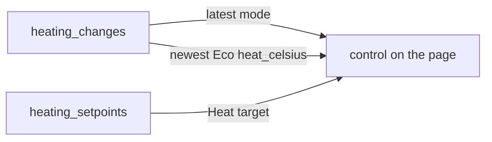
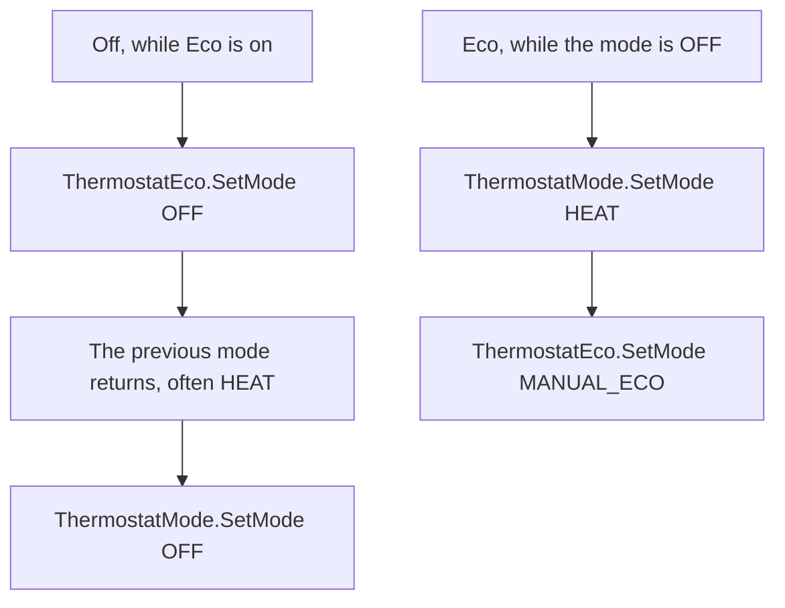
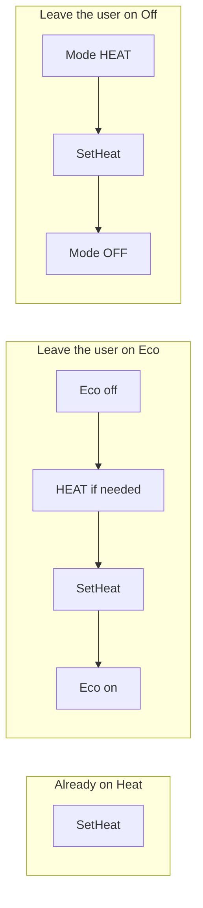
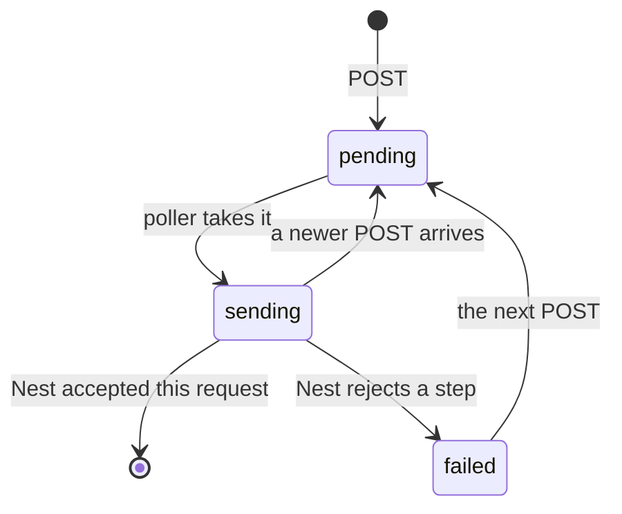
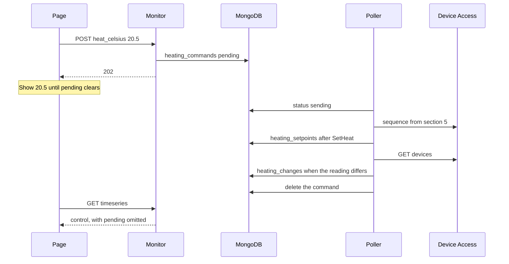
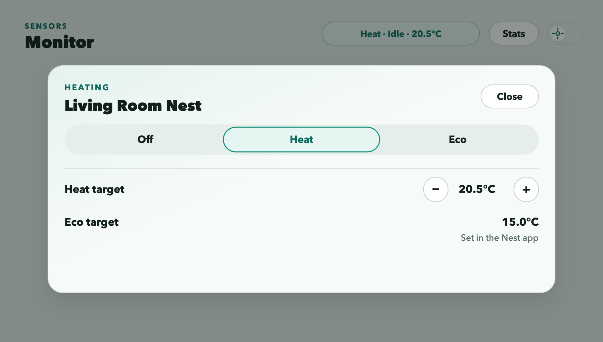
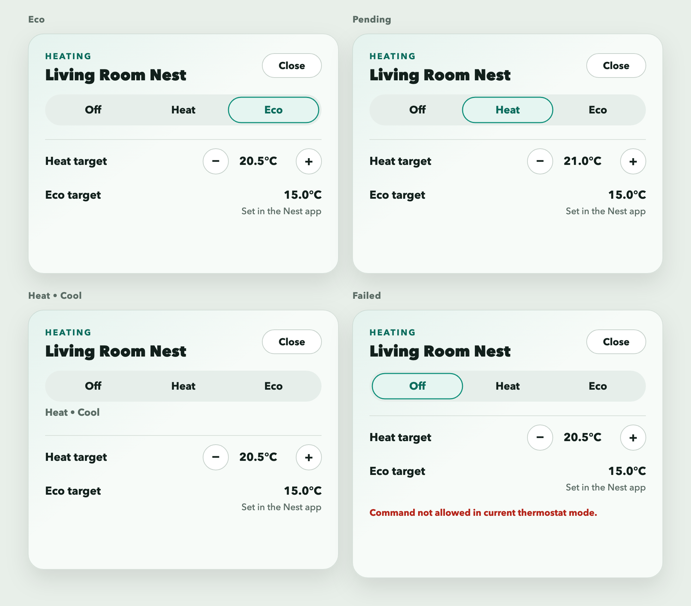

# Monitor heating control

Status: **Proposed** (2026-11-15)  
Scope: Turn the Monitor heating pill into a control for Off, Heat, and Eco, and for the Heat target temperature

Related: `design/Monitor-Heating.md` (the wash, the pill, and the Stats dialog as built). The poller that writes `heating_changes` is the Nest loop in `rust-backend`, described in that repo’s `Design/heating-state-changes.md`.

Figures such as `20.5°C` show the shape of a label. They are not a reading from the house.

---

## 1. Goal

From the Monitor page, set the one thermostat to **Off**, **Heat**, or **Eco**, and set the temperature it aims for while it is in Heat.

**On** in this request is Heat. The page does not offer Cool or Heat • Cool, and it does not edit a schedule.

The Eco temperature is shown beside the Heat target. Device Access does not accept a write to it, so this page does not send one. Section 4 is that limit.

Out of scope:

- Cooling, a cool target, or `SetCool` / `SetRange`
- Schedules, fan, hot water, away, or presence
- A second thermostat. The same one-device rule as the wash still applies
- Writing the Nest app’s Eco temperature by any path other than Device Access

---

## 2. What is already true

`web_database.heating_changes` is one row when the thermostat combination changes. The poller GETs Device Access about once a minute and inserts a row only when `hvac_status`, `mode`, `heat_celsius`, or `cool_celsius` differs. The website never calls Nest. Nest credentials stay in the poller’s `secrets/nest_credentials.json`.

While Eco is selected, the stored `mode` is `MANUAL_ECO` or `ECO`, and `heat_celsius` on that row is `ThermostatEco.heatCelsius`. While Heat is selected, `mode` is `HEAT` and `heat_celsius` is `ThermostatTemperatureSetpoint.heatCelsius`. A GET returns only the active mode’s temperatures, so one row never carries both targets. The latest row’s `heat_celsius` is whichever target is in force, not a pair.



`heating_setpoints` is the new document that remembers the Heat target after the thermostat leaves Heat. Section 6 says when it is written. An Eco row does not replace it.

The pill already shows that latest mode, whether the equipment is heating, and that one temperature. Stats stays the heating-time dialog. This change does not redraw the wash or the Stats charts.

---

## 3. The three controls

| Control | Sends | Stored as |
| --- | --- | --- |
| Off | Thermostat mode `OFF`, with Eco turned off first when Eco is on | `mode` `OFF` |
| Heat | Thermostat mode `HEAT`, with Eco turned off first when Eco is on | `mode` `HEAT` |
| Eco | Eco mode `MANUAL_ECO` | `mode` `MANUAL_ECO` or `ECO` |
| Heat target | `SetHeat` with `heatCelsius` | The Heat setpoint, including while the thermostat is left on Off or Eco |

The Heat target is the comfort setpoint. It is not the Eco temperature, and it is not `cool_celsius`.

The website accepts a Heat target from **9.0°C to 32.0°C** in steps of **0.5°C**. Anything else is rejected before a command is written. Nest can still reject a value inside that range. That rejection fails the command. It does not widen the stepper.

`COOL`, `HEATCOOL`, and `HEAT_COOL` are not choices. If the latest row is one of those, none of Off, Heat, or Eco is selected, and the dialog names that mode the same way the pill does (`Cool`, `Heat • Cool`). Choosing Heat or Off from there is allowed and replaces that mode.

---

## 4. Eco temperature

Device Access returns `ThermostatEco.heatCelsius` and documents it as set by the user. The trait’s only command is `ThermostatEco.SetMode` (`MANUAL_ECO` or `OFF`). There is no command that takes an Eco temperature. `SetHeat` is rejected while Eco is on, and it changes the Heat setpoint, not the Eco one.

The dialog shows the Eco temperature from the newest `heating_changes` row whose `mode` is `ECO` or `MANUAL_ECO` and whose `heat_celsius` is present. One decimal, `15.0°C`. When no such row exists, the value is `—`. The row is text, with the caption **Set in the Nest app**. It is not a stepper and it does not POST.

`ThermostatEco.coolCelsius` stays on the change row and is not shown here.

---

## 5. What a change sends

The poller turns one accepted request into the shortest Device Access sequence that leaves the thermostat as asked. It uses the device resource `name` (`enterprises/{project}/devices/{id}`), which the devices GET already returns and which `NestDevice` does not yet keep. Display name still selects the device. The website never sees the resource name.

Commands, in order. A step that is already true is skipped.

| Request | Eco on now | Mode now | Sequence |
| --- | --- | --- | --- |
| Off | yes | any | `ThermostatEco.SetMode` `OFF`, then `ThermostatMode.SetMode` `OFF` |
| Off | no | not `OFF` | `ThermostatMode.SetMode` `OFF` |
| Off | no | `OFF` | no command |
| Heat | yes | any | `ThermostatEco.SetMode` `OFF`, then `ThermostatMode.SetMode` `HEAT` if the restored mode is not `HEAT` |
| Heat | no | not `HEAT` | `ThermostatMode.SetMode` `HEAT` |
| Heat | no | `HEAT` | no command |
| Eco | no | `OFF` | `ThermostatMode.SetMode` `HEAT`, then `ThermostatEco.SetMode` `MANUAL_ECO` |
| Eco | no | `HEAT`, `COOL`, or `HEATCOOL` | `ThermostatEco.SetMode` `MANUAL_ECO` |
| Eco | yes | any | no command |

`ThermostatEco.SetMode` `OFF` restores the previous standard mode. Off therefore always follows it with `ThermostatMode.SetMode` `OFF`, or the heating would come back on. Eco from Off goes to Heat first, because some models reject Eco while the thermostat mode is Off.



A Heat-target request is `ThermostatTemperatureSetpoint.SetHeat`. Device Access rejects that unless the mode is Heat, so the poller brackets it and then restores the mode the user did not ask to leave:

| Mode to preserve | Around `SetHeat` |
| --- | --- |
| Heat, Eco off | `SetHeat` only |
| Eco | Eco off, Heat if needed, `SetHeat`, then `ThermostatEco.SetMode` `MANUAL_ECO` |
| Off | `ThermostatMode.SetMode` `HEAT`, `SetHeat`, `ThermostatMode.SetMode` `OFF` |
| Cool or Heat • Cool | `ThermostatMode.SetMode` `HEAT`, then `SetHeat`. This leaves the thermostat on Heat |



The Off and Eco brackets run as one sequence. The equipment may call for heat during the Heat step. The poller does not pause for the minute loop inside a sequence.

After the sequence it GETs the devices once and stores a `heating_changes` row by the existing difference rule. That GET is the confirmation the page waits for. The minute loop is unchanged and still picks up a change made in the Nest app.

A successful `SetHeat` writes the commanded temperature into `heating_setpoints` immediately, before the following GET. The GET at the end of an Off or Eco bracket does not include the comfort setpoint, so that document is the only record of a target set while the thermostat is not left on Heat.

---

## 6. Commands

Database `web_database`, collection `heating_commands`. One document per `device_name`. The website upserts it. The poller is the only writer of `status`.

```json
{
  "device_name": "Living Room Nest",
  "requested_at": { "$date": "2026-11-15T15:00:00.000Z" },
  "mode": "HEAT",
  "heat_celsius": null,
  "status": "pending",
  "error": null
}
```

A mode request sets `mode` to `OFF`, `HEAT`, or `ECO` and leaves `heat_celsius` null. A target request sets `heat_celsius` and leaves `mode` null. Exactly one of those two fields is set. `ECO` on the command means “turn Eco on”. The poller sends `MANUAL_ECO`.

`status` is `pending`, `sending`, or `failed`. A finished sequence deletes the document only when `requested_at` is still the one it executed. A POST that arrives during `sending` overwrites the document back to `pending` with a new `requested_at`. The poller runs that next. It does not merge two requests into one sequence.



The poller looks for `pending` about every 2 seconds, separately from the 60-second devices GET. It sets `sending`, runs section 5, and on success deletes the document if it is still the same request. On failure it sets `failed` and `error` to a short Nest reason (`Command not allowed in current thermostat mode` stays the idea; the stored string is the message Nest returned, trimmed). A failed document stays until the next POST replaces it. The 2-second loop does not retry a failure.

No thermostat with that display name, or more than one: set `failed` and do not call Nest.

`heating_setpoints` is one document per `device_name`:

```json
{
  "device_name": "Living Room Nest",
  "heat_celsius": 20.5,
  "heat_at": { "$date": "2026-11-15T15:00:02.000Z" }
}
```

It updates in two cases. A successful `SetHeat` sets `heat_celsius` to the commanded value and `heat_at` to that time. A `heating_changes` row with `mode` `HEAT` and a `heat_celsius` whose timestamp is at or after `heat_at` overwrites both. A row in Eco, Off, Cool, or Heat • Cool does not.

---

## 7. What the page reads

`GET /tools/monitor/timeseries` and `GET /tools/monitor/timeseries/` gain `control` on `heating` when the series exists. It is omitted with the rest of `heating` when the device rule omits the series. The 5-second poll already refreshes this. There is no second status URL.



```json
{
  "heating": {
    "device_name": "Living Room Nest",
    "device_id": "living-room-nest",
    "control": {
      "mode": "HEAT",
      "heat_celsius": 20.5,
      "eco_celsius": 15.0,
      "pending": null,
      "error": null
    },
    "changes": []
  }
}
```

| Field | Rule |
| --- | --- |
| `mode` | Latest in-force `mode`, one of `OFF`, `HEAT`, `ECO`, `COOL`, `HEATCOOL`. `MANUAL_ECO` and `ECO` both become `ECO`. `HEAT_COOL` becomes `HEATCOOL`. Omitted when the latest row has none |
| `heat_celsius` | `heating_setpoints.heat_celsius` for this device. Omitted when that document does not exist |
| `eco_celsius` | Newest change row for this device with Eco mode and `heat_celsius`. Omitted when none exists |
| `pending` | `"mode"` or `"heat"` while `heating_commands.status` is `pending` or `sending`. Omitted when there is no command document |
| `error` | `heating_commands.error` while `status` is `failed`. Omitted otherwise |

`changes` is unchanged. The wash and Stats ignore `control`.

`POST /tools/monitor/heating/control` and `POST /tools/monitor/heating/control/` take one JSON object, either `{ "mode": "OFF" | "HEAT" | "ECO" }` or `{ "heat_celsius": 20.5 }`. The device is the one the timeseries rule would select for `since` of now minus 14 days. No single device: **404**. A body with both fields, neither field, an unknown mode, or a temperature outside section 3: **400**. Success: **202** and the upserted command. The handler does not wait for Nest.

The route uses the existing CSRF check (`x-csrf-token` matching the `csrf_token` cookie, same origin). The monitor page already receives that cookie from the site middleware. The template puts the token on the control dialog as `data-csrf-token`. Nginx still requires a tools user before the request reaches FastAPI. The service worker does not cache this POST. It does not need a new network-first path; the live state arrives on `/timeseries/`.

---

## 8. The dialog

The pill `#heating-state` becomes a button. It keeps its place, its wording, and its colours. `aria-haspopup="dialog"` and `aria-expanded` point at `#heating-control-dialog`. The accessible name stays the spoken mode, activity, and target. Stats stays the next control. The pill stays hidden when `heating` is missing, and the dialog cannot be opened.


Opening reads `control` already on the page. Focus returns to the pill on close. Escape and a click on the backdrop close it. It uses the same frosted `<dialog>` shell as Stats, without the range switcher, the view menu, or the pager.



```
HEATING                                         ( Close )
Living Room Nest

[ Off | Heat | Eco ]

Heat target          −  20.5°C  +
Eco target              15.0°C
                        Set in the Nest app
```

The same dialog in four readings. The words above the cards belong to the figure. The dialog does not show them.



Off, Heat, and Eco are one radiogroup. The selected segment uses the live teal. Heat target is a pair of buttons around the value. Minus and plus move by 0.5°C and stop at 9.0°C and 32.0°C. Each press POSTs that temperature. Choosing a segment POSTs that mode. The number is not a text field.

The device name is the thermostat’s `device_name`. While the latest mode is Cool or Heat • Cool, the radiogroup has no pressed segment and a line under it reads that mode.

A pending mode presses the requested segment. A pending temperature shows the requested value. A timeseries poll keeps that request on screen until `pending` is gone. When `pending` clears and `error` is absent, the dialog shows `control` as returned. When `error` is present, the dialog shows the confirmed `mode` and `heat_celsius` again and one line of the error under the controls. Closing the dialog hides the line. The next successful POST clears it.

The pill follows the same pending values, so it does not flip back to the old mode while a command is in flight. Activity (`Heating` / `Idle`) still comes from `hvac_status` and is not part of the request. A failed command puts the pill back to the confirmed reading.

`prefers-reduced-motion` does not change this dialog. It has no height animation.

---

## 9. Where it lives

| File | Role |
| --- | --- |
| `website/tools/monitor/models.py` | `HeatingControl` on `HeatingSeries`. Validation of the POST body |
| `website/tools/monitor/__init__.py` | `heating_commands` and `heating_setpoints` collections |
| `website/tools/monitor/router.py` | Fill `control` on the timeseries read. `POST /heating/control` |
| `website/templates/tools/monitor/monitor.html` | Pill becomes a button. Control dialog shell and CSRF token |
| `website/static/js/tools/monitor/monitor.js` | Open, POST, pending display |
| `website/static/css/tools/monitor/monitor.css` | Segmented control and stepper |
| `website/tests/test_monitor_heating.py` | POST validation, the one-device rule, and the `control` object |
| `rust-backend` `backend/src/sensor_control/nest.rs` | 2-second command check, execute sequence, confirming GET |
| `rust-backend` `backend/src/sensor_control/models.rs` | Keep the device resource `name`. Map a sequence from the command and the current traits |

When `monitor.js` or `monitor.css` changes, raise its query in the template and in both precache lists, and raise `serviceWorkerPath`, `TOOLS_CACHE_VERSION`, and `MONITOR_CACHE_VERSION` together, as `design/Monitor-Heating.md` already requires.

---

## 10. Decisions

1. Off, Heat, and Eco are the only modes this page sets. Heat is the On state. Cool, Heat • Cool, schedules, and the cool target stay out.
2. The Heat target is `SetHeat`, 9.0–32.0°C in 0.5°C steps. Changing it while the thermostat is on Eco or Off is done by a short bracket that restores that mode. Changing it while Cool or Heat • Cool is selected leaves the thermostat on Heat.
3. The Eco temperature is shown from the newest Eco change row and is not sent. Device Access has no command for it. The caption tells the reader it is set in the Nest app.
4. The website writes `heating_commands` and reads `heating_setpoints`. The poller calls Nest. Credentials stay with the poller.
5. One command document per thermostat. A newer POST replaces one that has not finished. Failures are not retried.
6. The poller runs a pending command within about 2 seconds, then GETs once so `heating_changes` confirms the mode. A successful `SetHeat` is recorded in `heating_setpoints` even when that GET no longer includes the comfort setpoint.
7. `control` rides on the existing timeseries payload. The pill opens one dialog. Stats is unchanged. The pill shows the request until the command settles, then the confirmed reading.
