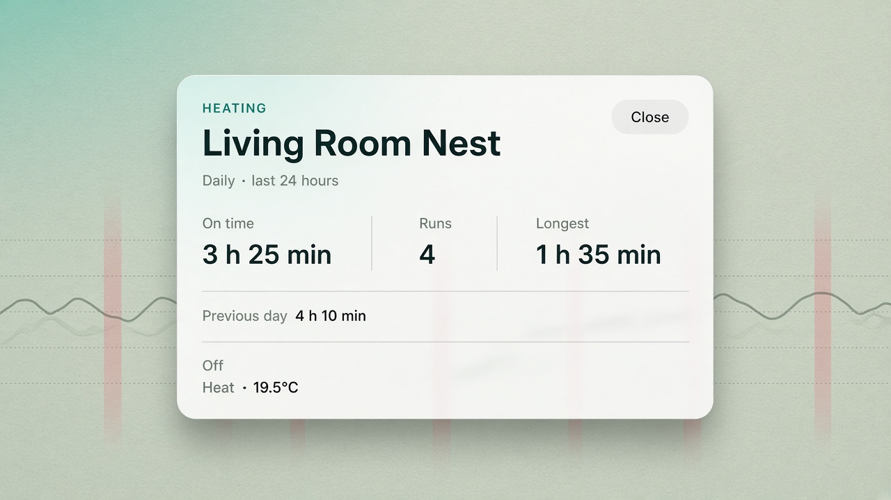
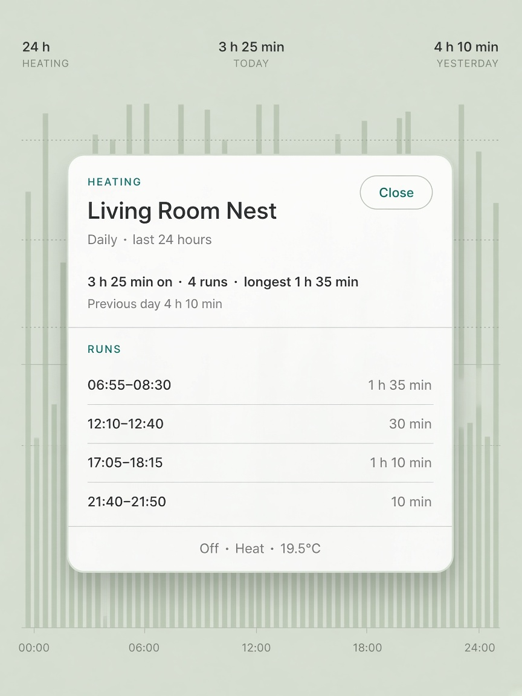
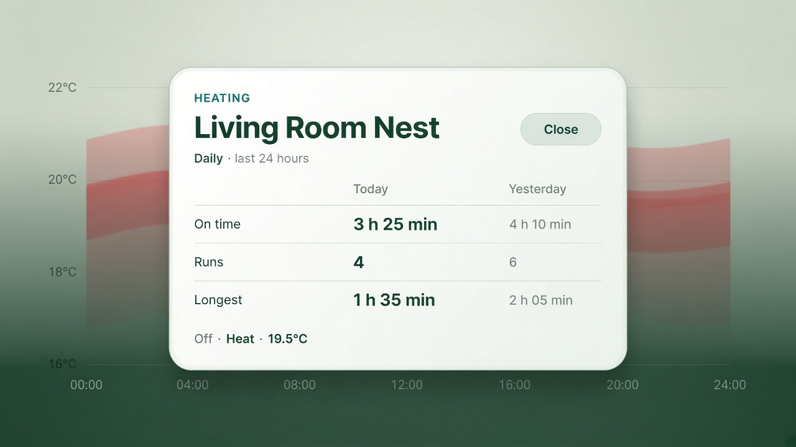
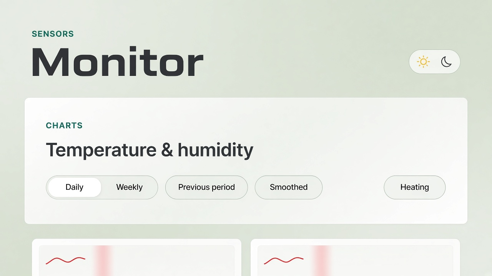

# Design: Monitor heating stats popup

Status: **Locked — B run list, topbar button** (2026-10-24)  
Date: 2026-10-24  
Scope: One house-level heating summary on the Monitor chart page

**How to use this doc**

- **§3 B** and **§4.1** are the chosen design. A, C, and the band-click entries stay as the options that were not picked.
- **§6** is the spec to build. The sample figures in §2 are illustrative, not a house reading.
- Further notes go in **§7**.
- Mockups are concept art, not pixel-spec. Type, spacing, and the heating wash will be rebuilt from Monitor tokens. The toolbar picture in §4 is the placement that was rejected.

Related:

- `design/Webapp-Design-Language.md` — dialogs, compact Monitor brand, panel toolbar (§3.2, §8)
- `website/templates/tools/monitor/monitor.html` — chart toolbar
- `website/static/js/tools/monitor/monitor.js` — `heatingRuns`, heating bands
- `website/tools/monitor/models.py` — heating samples already on the timeseries payload

---

## 1. Goal

Answer “how long has the heating been on?” without leaving the charts.

The popup is one native `<dialog>` for the whole house. The same Nest timeline is already painted on every room chart, so the stats must not be repeated inside each card.

The first version uses data the page already has. No new endpoint, no energy tariff, no setpoint editing.

Non-goals:

- A separate usage page
- Kilowatt-hours, cost, or a degree-day model
- Cooling totals (cooling may appear as the current status only)
- Per-room heating, or more than the one thermostat series the chart already chooses
- Changing how the red heating bands are drawn

---

## 2. What the popup can say

Figures below are **illustrative**, so the layouts can be compared. They are not a reading from the house.

| | This period | Previous period |
| --- | --- | --- |
| Window | Daily · last 24 hours | Previous day |
| On time | 3 h 25 min | 4 h 10 min |
| Runs | 4 | 6 |
| Longest | 1 h 35 min | 2 h 05 min |
| Now | Off · Heat · 19.5°C | — |

The four runs that add up to 3 h 25 min:

| From | To | Duration |
| --- | --- | --- |
| 06:55 | 08:30 | 1 h 35 min |
| 12:10 | 12:40 | 30 min |
| 17:05 | 18:15 | 1 h 10 min |
| 21:40 | 21:50 | 10 min |

Rules for the real numbers, whichever layout wins:

1. **Same runs as the stripes.** On time, run count, longest run, and the list all come from `heatingRuns`: half a sample interval before the first on reading, half an interval after the last, split when the gap is longer than two intervals. A run clipped by the chart window counts only the part inside the window, so the total matches the painted wash.
2. **Period follows the chart.** Daily is the rolling 24 hours. Weekly is the rolling 7 days. The comparison is the equal window immediately before. Both fit in the 14-day timeseries payload.
3. **Local time.** Run clocks are the browser’s local time. Durations are `30 min`, `2 h`, or `1 h 35 min`. A clipped fragment under a minute is `< 1 min`. No seconds.
4. **Status is the latest sample.** `HEATING` → Heating, `OFF` → Off, `COOLING` → Cooling. Setpoint is the latest `heat_celsius` or `cool_celsius` that belongs to the current mode, one decimal, same as the room temperatures. If mode or setpoint is absent, that piece is omitted.
5. **Nothing measured is not zero.** No heating samples at all: the dialog says “No heating readings” and does not show a zero row. Samples exist, but none are on in this window: On time is `0 min`, Runs is `0`, Longest is `—`.

---

## 3. Layout

Locked: **B — Headline and run list**.

- [ ] **A — Headline**
- [x] **B — Headline and run list**
- [ ] **C — This period beside the last**

Shared chrome for all three: frosted dialog, teal `HEATING` kicker, thermostat name, Close pill, period line, and a quiet status line (`Off · Heat · 19.5°C`). Converter’s overview dialog is the pattern (`<dialog>`, backdrop, focus trap, Escape closes).

### A — Headline

Three numbers, then one comparison line. No list.

**Use if:** the popup should answer in one glance and then go away.



```text
┌──────────────────────────────────────────────┐
│ HEATING                              Close   │
│ Living Room Nest                             │
│ Daily · last 24 hours                        │
│                                              │
│ On time          Runs           Longest      │
│ 3 h 25 min       4              1 h 35 min   │
│                                              │
│ Previous day  4 h 10 min                     │
│ Off · Heat · 19.5°C                          │
└──────────────────────────────────────────────┘
```

| Fits well | Watch-outs |
| --------- | ---------- |
| Phone width; three figures still fit | You cannot see *when* it was on without going back to the chart |
| Weekly, where a run list gets long | The comparison is easy to miss under the hero numbers |
| Opening and closing often | Longest has no start time |

---

### B — Headline and run list

One summary sentence, then each run as a row: local start–end, duration on the right.

The dialog itself does not scroll. The run list is its own container and is the only region that scrolls. Header, summary, comparison line, and status stay in view. On a long week the list scrolls inside the dialog; the page behind it does not move.



The bars behind this card are not part of the proposal. Only the dialog counts. The mockup shows a short list with no overflow; the scroll region is the `RUNS` block between the two rules.

```text
┌──────────────────────────────────────────────┐
│ HEATING                              Close   │  stays
│ Living Room Nest                             │
│ Daily · last 24 hours                        │
│                                              │
│ 3 h 25 min on · 4 runs · longest 1 h 35 min  │  stays
│ Previous day  4 h 10 min                     │
├──────────────────────────────────────────────┤
│ RUNS                                         │
│ 06:55–08:30                        1 h 35 min│  scrolls
│ 12:10–12:40                            30 min│
│ 17:05–18:15                        1 h 10 min│
│ 21:40–21:50                            10 min│
├──────────────────────────────────────────────┤
│ Off · Heat · 19.5°C                          │  stays
└──────────────────────────────────────────────┘
```

| Fits well | Watch-outs |
| --------- | ---------- |
| Daily, usually a handful of runs | The list duplicates the red wash; that is accepted |
| Checking a band you remember (“the morning one”) | Give the scrollport a visible edge so a short list and a cut-off list do not look the same |
| An empty period: the list area says “No heating in this period” | The empty line sits in the list container, not in place of the summary |

---

### C — This period beside the last

Today and yesterday (or this week and last week) as two columns. On time, runs, and longest in both.

**Use if:** the useful question is “more or less than last time?”, which the chart’s previous-period line does not answer for heating.



```text
┌──────────────────────────────────────────────┐
│ HEATING                              Close   │
│ Living Room Nest                             │
│ Daily · last 24 hours                        │
│                                              │
│                 Today        Yesterday       │
│ On time         3 h 25 min   4 h 10 min      │
│ Runs            4            6               │
│ Longest         1 h 35 min   2 h 05 min      │
│                                              │
│ Off · Heat · 19.5°C                          │
└──────────────────────────────────────────────┘
```

| Fits well | Watch-outs |
| --------- | ---------- |
| The chart already offers a previous-period overlay for temperature | Two columns of durations get tight under ~360px; stack the previous period under the current one rather than shrinking type |
| A weekly “was this week heavier?” check | No run times |
| Keeping the dialog short | Column headers must change with the chart: Today/Yesterday, or This week/Last week |

---

## 4. Entry

Locked: **1 — Topbar button**, to the left of the day/night switch. Not in the chart toolbar: that row does not fit another control on mobile. Heating bands stay non-interactive.

- [x] **1 — Topbar button**
- [ ] **2 — Click a heating band**
- [ ] **3 — Button, and a band opens the same dialog**

The heating series is house-level. The button opens one dialog for the house, not a per-room total.

### 1 — Topbar button

A `Heating` pill in `.topbar-actions`, immediately before the theme switch. The chart controls stay Daily / Weekly, Previous period, and Smoothed. `aria-haspopup="dialog"`, `aria-expanded` while open. Focus returns to this button on close.

```text
Sensors                                        
Monitor                    [ Heating ]  (theme)
```

The picture below was the earlier idea, a Heating pill on the chart toolbar. That placement is rejected.



| Fits well | Watch-outs |
| --------- | ---------- |
| The topbar has room on mobile; the chart toolbar does not | The button does not show the on-time until the dialog opens |
| One control for a house-level fact | Keep the label `Heating`. Do not shorten it to `Heat` |
| Keyboard access, next to a control that is already there | Match the theme switch height so the topbar row does not grow |

### 2 — Click a heating band

The red wash becomes clickable. The dialog is the same house summary, not a tooltip for that one run. Bands stay `pointer-events: none` until this option is chosen.

| Fits well | Watch-outs |
| --------- | ---------- |
| The wash is already the heating affordance | Easy to miss when the boiler has been off and there is no band |
| Someone who just noticed a stripe | The same stripes repeat on every room chart; the hit target is ambiguous |
| — | Scrubbing and chart drag must not also open the dialog |

### 3 — Button, and a band opens the same dialog

Toolbar button for the empty and keyboard paths. A band click also opens the dialog. If layout **B** wins, the clicked run is the row brought into view. Other layouts ignore which band was hit.

| Fits well | Watch-outs |
| --------- | ---------- |
| Both ways of arriving | Two gestures, one result, unless B scrolls to the run |
| Layout B | Band clicks must not fight chart scrubbing |

---

## 5. Shared constraints

1. **Monitor chrome.** Paper, frosted `--surface-strong` panel, `--radius-lg`, teal kicker, Schibsted for the title and the figures, Inter for the facts. Heating red is for the chart wash and, if needed, the word Heating in the status line. It is not a second theme for the dialog.
2. **One dialog.** Not a popover per chart, not a drawer, not a new route. The dialog box does not scroll. Only the runs container scrolls.
3. **Period is the chart’s period.** Switching Daily/Weekly while the dialog is open updates the figures in place. The previous-period checkbox does not hide the comparison; the comparison is always the previous window. The label is `Previous day` on Daily and `Previous week` on Weekly. Not “Previous period”.
4. **Quiet motion.** Fade the backdrop. No pulse on “Heating”. Respect `prefers-reduced-motion`.
5. **Empty copy, inside the dialog.** “No heating readings” when the series is missing. “No heating in this period” inside the runs container when the total is `0 min`. The summary line still shows `0 min on · 0 runs`. The page underneath does not change height.
6. **Dark mode.** Same structure on the dark paper tokens. The mockups show light mode only.

---

## 6. Spec to build

Locked from §7:

- Layout **B**. Header, summary (`3 h 25 min on · 4 runs · longest 1 h 35 min`), `Previous day` / `Previous week`, and the status line stay put. The runs list is a separate scroll container.
- Entry is a `Heating` button in the topbar, to the left of the day/night switch.
- Comparison label is `Previous day` (and `Previous week` when the chart is weekly).
- The sample figures in §2 are accepted.

Build it client-side: read `heatingSeries`, call the same run function the bands use, and mount one `<dialog>` from the Monitor page. Cache-bust `monitor.js` and `monitor.css` with the change. Heating bands stay `pointer-events: none`.

---

## 7. Iteration notes

Decided 2026-10-24:

- Layout: B. The run list is its own container. The dialog does not scroll; only the list of runs does.
- Entry: button to the left of the day/night switch. It does not fit in the chart toolbar on mobile.
- Comparison label: `Previous day`.
- Sample figures: accepted.

Further notes:
