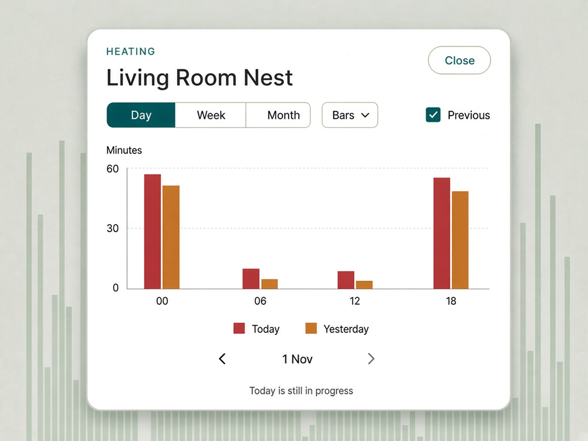
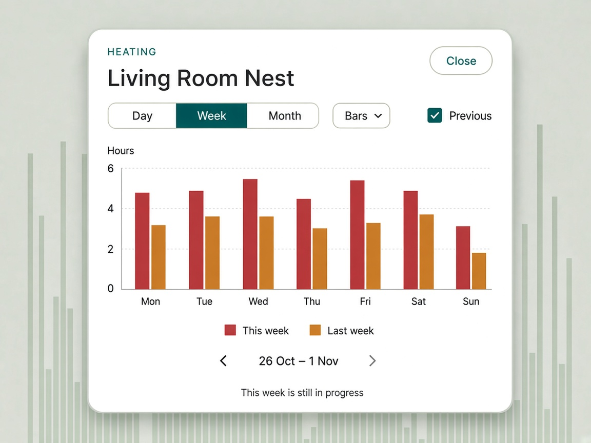
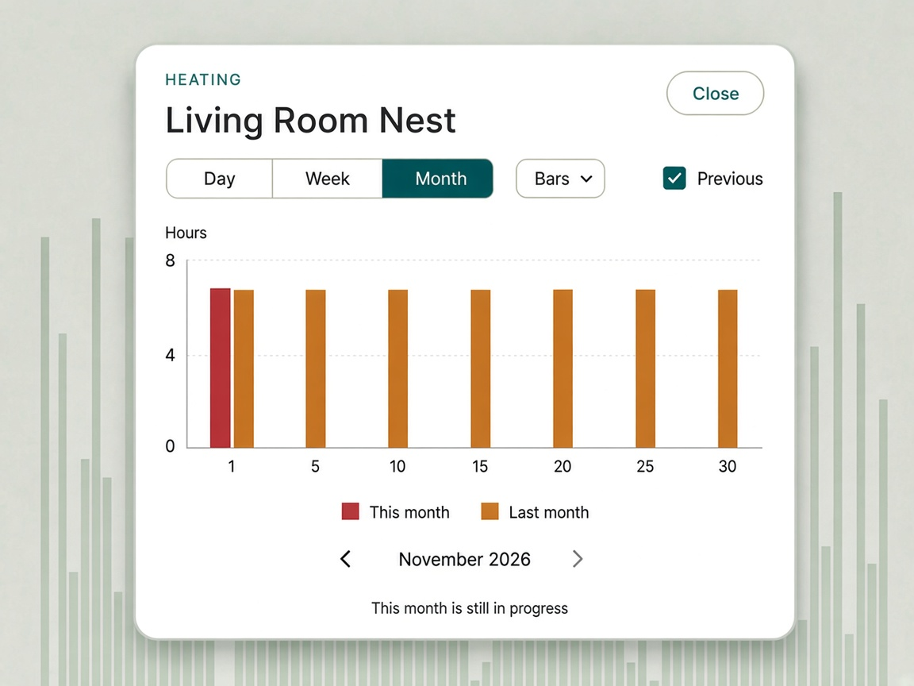
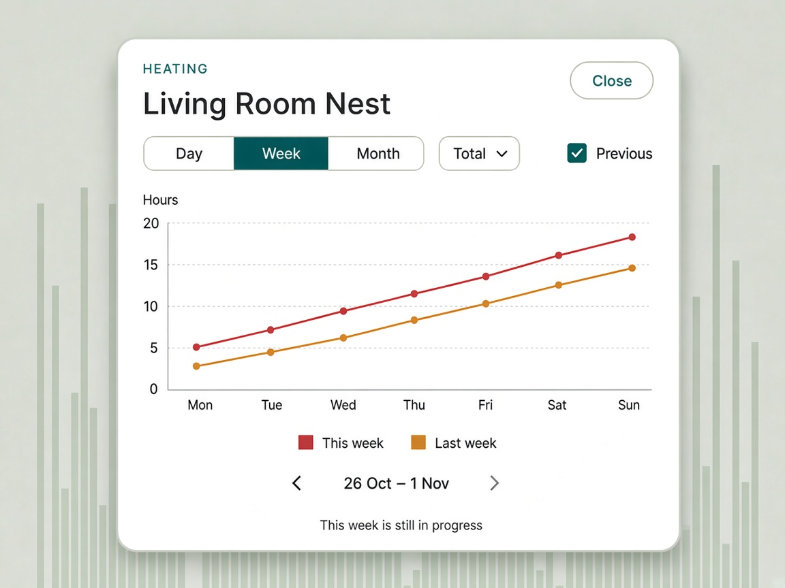
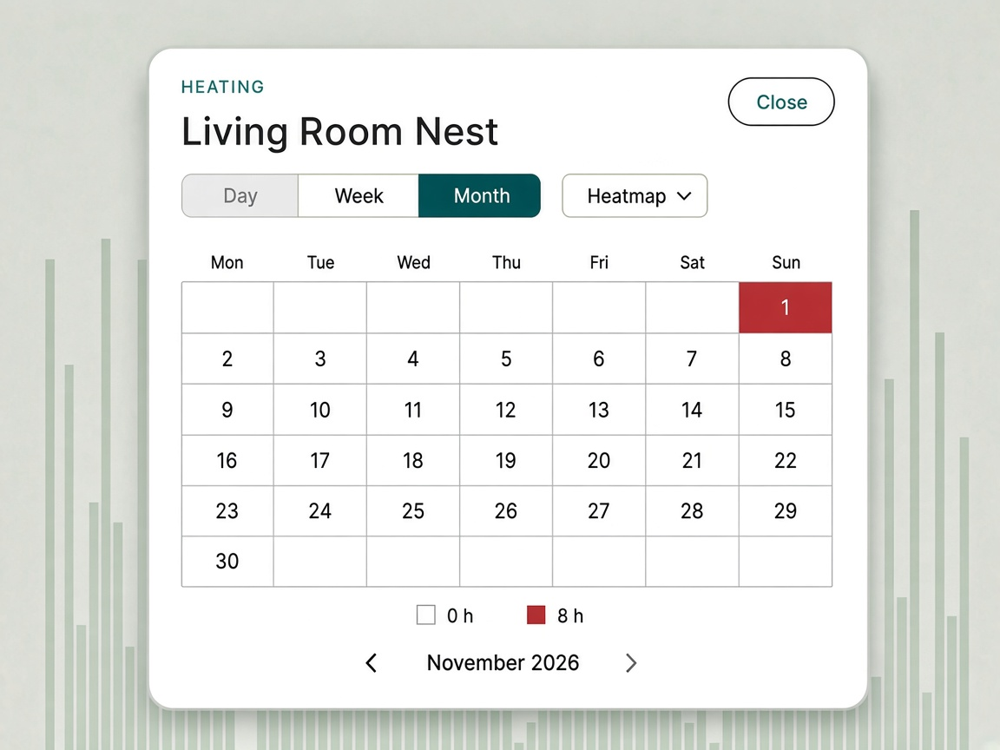

# Design: Monitor heating time dialog

Status: **Proposal — one Stats dialog** (2026-11-01)  
Date: 2026-11-01  
Scope: One house-level dialog of heating time, opened by the existing Stats button

**How to use this doc**

- **§2** is the dialog. **§3** is shared for every view. **§4** is the views to build: Bars (Day, Week, Month), Total, and Heatmap.
- **§6** is how a later view or range is added. It is a new entry in a list, not a new dialog.
- The hours in the pictures are illustrative, not a house reading.
- Mockups are concept art, not pixel-spec. Type, spacing, and colours will be rebuilt from Monitor tokens. Grey marks behind a card, where a picture has them, are the room temperature chart and are not part of this dialog.
- Every picture uses the same row: the range control, then the view menu (`Bars ▾`, `Total ▾`, or `Heatmap ▾`) aligned to the right. The previous period is always drawn on Bars and Total. There is no Previous checkbox.
- The earlier paired heating-and-cooling chart is withdrawn. This house has no cooling. `COOLING` only ends a heating run.
- The thirteen-week chart is withdrawn. There is no year of months. Month is the days of one month.
- The Stats run list in `design/Monitor-Heating-Stats.md` is withdrawn. The Stats button opens this dialog.

Related:

- `design/heating-webapp-interface.md` — `heating.changes` and the run rule
- `design/Monitor-Heating-Stats.md` — the run list this dialog replaces
- `design/Webapp-Design-Language.md` — dialogs, compact Monitor brand (§3.2, §8)
- `website/templates/tools/monitor/monitor.html` — topbar, Stats button

---

## 1. Goal

Answer “how much heating time was there in this stretch of the calendar, and how does that compare with the stretch before it?”

The room charts plot degrees. The red wash is when the heating is running inside the rolling window. This dialog is the history: heating time for a day, a week, or a month, drawn as bars, as a running total, or as a month heatmap.

It is one native `<dialog>` for the whole house. There is one thermostat. The chart is not repeated inside each room card.

Non-goals:

- Cooling bars, a cooling total, or a cooling colour
- A temperature series, a degree axis, or the red wash
- Keeping the Stats run list, the on-time sentence, the run count, or the status line
- A second button or a second dialog beside Stats
- Kilowatt-hours, cost, or a degree-day model
- Per-room heating, or more than the one thermostat
- A count of days that had any heating. The height is time on, not “how many days did it fire?”
- A bar per week across a quarter, or a bar per month across a year

---

## 2. The dialog

The existing **Stats** button in `.topbar-actions` opens `#heating-stats-dialog`. There is no Hours button. The dialog body replaces the run list. The button label stays Stats.

```
HEATING                                         ( Close )
Living Room Nest

[ Day | Week | Month ]                         Total ▾

<the active view>

        ‹   26 Oct – 1 Nov   ›
```

One row. The range is the segmented control, drawn from the range list (§6). The selected segment uses the live teal. The view is a menu button at the right of that same row, labelled with the active view and a chevron (`Bars ▾`, `Total ▾`, `Heatmap ▾`). The pager sits under the chart and steps the active range by one window. The heatmap fits in the dialog; the dialog does not scroll.

Opening the menu shows the view list: Bars, Total, Heatmap, with the active one marked. Choosing an item closes the menu and redraws. Clicking outside the menu, or Escape while it is open, closes the menu and leaves the dialog open. A second Escape closes the dialog. The menu button has `aria-haspopup="menu"` and `aria-expanded`. Arrow keys move in the list and Enter chooses.

Opening the dialog sets the cursor to today and selects **Bars** and **Day**. Closing returns focus to the Stats button. Escape and the backdrop close the dialog, same as today. `aria-haspopup="dialog"` and `aria-expanded` stay on the Stats button.

Switching range keeps the cursor and the view. Switching view keeps the cursor. Heatmap only supports Month: choosing it selects Month and disables Day and Week. Those segments stay in the row so the control does not change length. Leaving Heatmap restores the range that was selected before it, when the new view supports that range. A view that compares periods always draws the previous window. Changing range, view, or page keeps the current drawing until the next one is ready.

On a narrow phone the view menu wraps under the range control, still aligned to the right. A later view is another item in the menu. It does not widen the row, become a native `<select>`, or open another dialog.

The chart toolbar is unchanged. Daily, Weekly, Previous period, and Smoothed still resize only the room temperature charts and the wash.

### Bars — Day



Twenty-four slots, midnight through 23:00. The vertical axis is **minutes**, fixed from 0 to 60, so a quiet hour does not stretch the scale. The picture only drew the hours it labelled. The build keeps all twenty-four slots. Tick labels are 00, 06, 12, and 18.

The range label is the calendar date, `1 Nov`. While the window contains today the legend reads **Today** and **Yesterday**. On an earlier date it reads that date and the date before it.

### Bars — Week



Seven slots, Monday through Sunday. The vertical axis is **hours**. The label is the week, `26 Oct – 1 Nov`. While the window contains today the legend reads **This week** and **Last week**.

### Bars — Month



The axis is always day 1 through 31, so a shorter month still has a slot for a later day in the previous month. The vertical axis is **hours**. A day the month on screen does not have, such as 31 in November or 30 in February, has no red bar. The label is the month, `November 2026`. While the window contains today the legend reads **This month** and **Last month**.

The picture only drew the day numbers it labelled. The build keeps all 31 day numbers. A day after today has no red bar. Last month has a teal bar on each of its own day numbers, including a day number this month does not have. A day number last month does not have leaves that teal half empty.

### Total



The same slots as Bars for the active range. Each point is the heating time accumulated from the start of the window through that slot. The line is heating red. The previous window is a second line in the live teal. There is no fill under either line. The shaded area in an earlier picture is not part of this view.

Day accumulates **minutes** and the axis can pass 60. Week and Month accumulate **hours**. The legend words match Bars for that range. A slot that has not started is not a point. The current line stops at now.

### Heatmap



One cell per day of the month on screen. Monday is the first column. Under the day number, a smaller duration (`1h 24m`, `42m`, `0m`) sits with it, and that pair is centred in the tile. A day that has not started shows only its number. The tint runs from the paper colour at 0 hours to solid heating red at 7 hours. A day with more than 7 hours stays at that solid red. A day that has not started is an empty cell, outside the scale, not a white zero. The picture’s later dates are those empty cells. A finished day with no heating is the lightest tint.

The heatmap does not draw a previous month. Day and Week are disabled and Month is selected. Each tile is square. On a narrow screen the tiles follow the dialog width. If that calendar would be taller than the dialog, the tiles shrink together and stay square, and the dialog does not scroll. The pager still steps a month. The legend is `0 h` to `7 h`.

---

## 3. Shared rules

These apply to every view that uses them. A view opts out by the flags in §6. Heatmap opts out of Previous. Nothing in the first set opts out of the pager.

### Windows

| Range | Slots | Unit on Bars | Pager steps |
| --- | --- | --- | --- |
| Day | 24 clock hours | Minutes, axis fixed 0–60 | One calendar day |
| Week | Mon–Sun | Hours | One week, Monday to Sunday |
| Month | Day 1 through 31 | Hours | One calendar month |

Weeks start on Monday. Days, weeks, and months are the browser’s local calendar. The cursor is a local date. Opening sets it to today.

The previous window is the same shape immediately before, aligned by slot: clock hour, weekday, or day number. Bars and Total always draw it. The current bar or point stays on the left.

The forward chevron is disabled when the window contains today. The back chevron is always enabled. Paging moves one whole window and keeps the view and the range.

### Zero, future, and a period still in progress

| Slot | Draw |
| --- | --- |
| Finished, no heating | A zero. The slot stays. On the heatmap this is the lightest tint. |
| Not started yet | Nothing. Not a zero. On the heatmap this is an empty cell. |
| In progress (today, this week, this month) | The real time so far. Not scaled up to a full period. |

On Day, an hour after now has no red bar. Yesterday’s later hours still draw. On Week, today is the height so far and the weekdays after today have no red bar. On Month, the same for day numbers after today. On Total, the line has no point for a slot that has not started. There is no caption saying the period is still in progress.

### Pointer text

Bars and Total use the duration words already in the Stats dialog: `42 min`, `4 h 10 min`, under a minute as `< 1 min`. The axis unit is coarser than the pointer. A bar of 1.4 hours reads `1 h 24 min`. Heatmap uses the same words on the cell.

Hovering or tapping a bar lights that bar and dims the others. Hovering or tapping a Total slot lights that slot’s points and dims the other points. There is no outline around the bar or the point.

### Colours

Current is solid heating red, `#b42318` in light and `#ff7a6e` in dark. Add `--heating-bar` for that solid fill. It is not the translucent `--heating-band` wash.

Previous is the live teal, `#0f8f7a` in light and `#2dceb2` in dark. The room chart keeps its amber for the previous temperature line.

On Bars the current bar is the left of the pair and the previous bar is the right. On Total the current line is red and the previous line is teal. The heatmap uses red only.

### Copy when there is nothing to draw

No thermostat, or a window with more than one `device_name`: “No heating readings”. The switchers and the pager stay.

Changes exist and a finished slot had no `HEATING`: that slot is a zero, as above. The dialog does not replace the chart with the empty-run sentence from the old stats view.

---

## 4. Where the hours come from

A heating run is the clipped `HEATING` interval from `design/heating-webapp-interface.md`. `OFF` and `COOLING` end a run. A later `HEATING` row that only changes mode or a threshold does not.

The room chart’s payload is the rolling 14 days. This dialog does not widen that payload. A month plus the previous month is longer than 14 days, and paging back goes further. The dialog asks for the span it is showing.

That span is the current window, plus the previous window when the view draws one, plus the one `heating_changes` row before the earlier start for the same `device_name`. The device rule matches the interface note: one device in the span, or the single steady device when the span is empty. Two devices omit the series. The query stays async Motor, and the naive `since` style stays.

Clip each run to the slot, start inclusive and end exclusive. A run crossing midnight counts in each slot it overlaps. A trailing `HEATING` extends to now on a window that contains now, and stops at the end of a window that does not. Sum the overlaps. Do not pass the rows through `smoothTemperatureSeries` or `alignPreviousPeriodData`.

Do not draw these runs on the room charts. The wash stays on `getPeriodBounds`.

---

## 5. What leaves the page

Remove the run list, the summary sentence, the comparison sentence, and the status line from `#heating-stats-dialog`. Remove the script that fills them (`buildHeatingStatsView` and the copy helpers that exist only for that list). Keep `formatHeatingDuration` for the pointer text.

The button, the `<dialog>`, focus return, and Escape stay. `getHeatingStatsBounds` can go. The dialog’s windows are the range functions in §6, not the old today / last-7-days pair.

---

## 6. Adding a view or a range

Two lists own the controls. The dialog shell does not mention Day, Week, Month, Bars, Total, or Heatmap by name. The range list is the segmented control. The view list is the menu. Adding a view adds a menu item, not a segment.

A **range** describes a window:

| Field | Role |
| --- | --- |
| `id`, `label` | Segment id and the word on the button |
| `window(cursor)` | `{ start, end }` in local time for the window that contains that date |
| `step(cursor, direction)` | The cursor moved one whole window back or forward |
| `slots(window)` | Ordered slots, each with a label and `{ start, end }` |
| `legend(window, which)` | “Today” / “Yesterday”, “This week” / “Last week”, and so on |
| `unit` | `minutes` or `hours`, for Bars and for the Total axis |
| `axisMax` | A fixed max such as 60, or none when the axis fits the data |

A **view** describes a drawing of the active range:

| Field | Role |
| --- | --- |
| `id`, `label` | Menu item id and the word in the menu. The menu button shows the active label |
| `ranges` | Range ids this view can draw. Heatmap is `["month"]` |
| `previous` | Whether this view draws the previous window. There is no checkbox |
| `pager` | Whether the pager is shown. All three current views set this |
| `draw(host, model)` | Replaces the contents of the chart host |

`model` is the shared result: the active range, the cursor, the current slots with their durations, and the previous slots when the view draws them. `draw` does not fetch and does not clip. Fetching and clipping live in one place so a new view cannot invent a second run rule.

Dialog state is `{ rangeId, viewId, cursor, rangeBeforeLock }`. Choosing a view whose `ranges` omit the current `rangeId` stores that id in `rangeBeforeLock` and selects the view’s first range. Choosing a view that includes `rangeBeforeLock` restores it.

The first lists are:

- Ranges: Day, Week, Month
- Views: Bars (`ranges` all three, `previous` true), Total (all three, `previous` true), Heatmap (`ranges` month only, `previous` false)

A later view is a new object plus a `draw`, and it shows up as a menu item. A later range is a new segment. Neither adds a button in the template, a second dialog, or a branch in the shell. A view that needs a range the lists do not have yet adds that range first.

---

## 7. Animating the dialog height

The card the user sees is `.heating-stats-panel`. Its height is the height of its content, capped by `min(90dvh, 40rem)`. The `<dialog>` is transparent and follows that card. The width is the viewport rule and does not change. Switching between Bars or Total and the heatmap, or between a 5-row month and a 6-row month, changes the card’s height. Opening does too: the card is the chrome until the first chart is drawn. A window resize also changes it, and that one stays instant.

The final height is the panel’s border box after three things are true: the new chart is in the document, `layoutHeatingHeatmap` has put `max-height` back, and no inline `height` and no height animation are applied. `getBoundingClientRect().height` at that moment is the number to animate to. It is not calculated from the row count, the SVG’s 248px, or the measurement `layoutHeatingHeatmap` takes while `max-height` is `none`.

### Steps

Do this at the end of a paint that replaced the chart, after the heatmap fit has returned.

1. Before replacing the chart, read the panel’s border-box height. If an animation is already running, this is the height on screen. Keep that number, then cancel the animation.
2. Draw. The heatmap fit restores `max-height` before it returns.
3. Read the border-box height again. That is the end.
4. If the two heights differ by less than a pixel, stop. The poll, a page that does not change the card, and a resize all land here.
5. Otherwise play a Web Animations effect on the panel: `{ height: start }` to `{ height: end }`, 260ms, `ease`, `fill: "none"`. Set `overflow: hidden` for the effect and clear it in both `onfinish` and `oncancel`.

`fill: "none"` means the effect is the only override. When it ends, the panel is `height: auto` again, which is the end height just measured. Do not write `style.height`. An inline pixel height left in place clips the chart when the finish event does not fire.

`box-sizing` is `border-box`, so the `height` property is the same border box `getBoundingClientRect()` returns. Check that once: on the first frame, the border box matches the start keyframe within a pixel. If it is taller by the panel’s vertical padding and border, subtract that constant, taken from `getComputedStyle`, from both keyframes. The constant does not depend on which chart is showing. Do not tune it by comparing the height after the animation with the height during it.

The new chart is already at its final size while the card eases. In-between frames do not refit the heatmap. The squares were fitted to the final max-height in step 2.

### When a second change arrives

Read the on-screen height before cancelling. Then cancel, draw, measure the new end, and start the new effect, all before the browser paints. Cancelling without that saved height would drop the card to `auto` for a frame.

A fetch does not animate. The chart on screen stays until the new span is drawn, and the effect starts then, from the height read in step 1 of that paint. The toolbar may gain or lose a wrapped row when Heatmap disables Day and Week; that small change happens with the chrome update and is not given its own effect.

The resize listener passes no animation. The card tracks the window. `prefers-reduced-motion: reduce` skips the effect as well.

Opening uses the same steps. `showModal` has already shown the chrome-only card; the first chart paint reads that height as the start.

---

## 8. Decisions

1. Heating only. `COOLING` ends a run and is not drawn.
2. One dialog, opened by the existing Stats button. The run list is removed. There is no Hours button.
3. One row. The range (Day, Week, Month) is the segmented control. The view (Bars, Total, Heatmap) is a menu on that row. A later view is a menu item. A later range is a segment.
4. Bars keep the Day, Week, and Month charts already specified. Total is the running sum of those slots. Heatmap is the month, one cell per day.
5. Bars and Total always draw the previous window: current on the left in heating red, previous on the right in teal. Heatmap does not draw a previous month. Its tiles are square and fit in the dialog without scrolling.
6. The pager sits under the chart. Forward is disabled when the window contains today.
7. A finished empty slot is zero. A slot that has not started draws nothing. The current period is the real time so far.
8. The dialog queries `heating_changes` for the span it shows, plus one prior row. It does not widen the room chart’s 14-day payload.
9. The card’s height eases by the method in §7. The end height is the settled border box after the chart is drawn. The effect does not leave an inline height behind. Resize stays instant.
