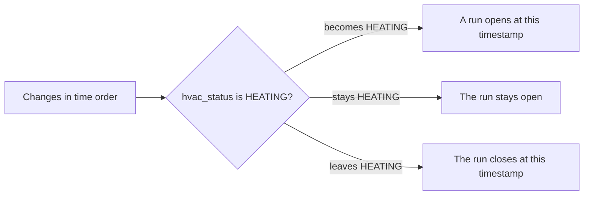

# Monitor heating

Status: **Current** (2026-11-01)  
Scope: The heating wash on the Monitor room charts, and the Stats dialog of heating time

This is the contract for the page as built. Figures such as `1 Nov` and `4 h 10 min` show the shape of a label. They are not a reading from the house.

Related: `design/Webapp-Design-Language.md` (dialogs, compact Monitor brand).

---

## 1. Goal

Show when the heating is running, and how much time it ran across a calendar day, week, or month.

The room charts plot degrees. A red wash behind the temperature line marks the times the heating is running inside the chart’s rolling window. The **Stats** button opens one dialog for the house: heating time for a day, a week, or a month, drawn as bars, a running total, or a month heatmap.

There is one thermostat. The same timeline is painted on every room chart. The dialog is not repeated inside each card.

Out of scope:

- Cooling as a drawn series. `COOLING` ends a heating run and stays on the stored row.
- Kilowatt-hours, cost, or a degree-day model
- A separate usage page. When one is built, its heating duration is the sum of these same clipped runs.
- Per-room heating, or more than one thermostat on one timeline
- A count of days that had any heating. Bar height and tile shade are time on.
- A bar per week across a quarter, or a bar per month across a year

---

## 2. Stored changes

Database `web_database`, collection `heating_changes`. The unique index is `{ device_name: 1, timestamp: -1 }`.

One row is written when the thermostat combination changes. Until the next row, those values stay in force. There is no sample interval and no gap rule. A steady `HEATING` at steady thresholds writes no further row, and that stretch is still one run.

```json
{
  "device_name": "Living Room Nest",
  "timestamp": { "$date": "2026-10-24T14:40:00.000Z" },
  "hvac_status": "OFF",
  "mode": "HEAT",
  "heat_celsius": 21.0
}
```

| Field | Rule |
| --- | --- |
| `device_name` | Nest display name. This house has one thermostat |
| `timestamp` | UTC time when this combination was first observed. Stored naive; treat it as UTC |
| `hvac_status` | `OFF`, `HEATING`, or `COOLING` |
| `mode` | Nest mode, such as `HEAT`, `COOL`, `HEATCOOL`, or `OFF`. Omitted when that poll had none |
| `heat_celsius` | Heat threshold. Omitted when Nest did not send it |
| `cool_celsius` | Cool threshold. Omitted when Nest did not send it |

A `HEAT` poll carries `heat_celsius` and omits `cool_celsius`. A `COOL` poll carries `cool_celsius` and omits `heat_celsius`. `HEATCOOL` carries both. A missing threshold is not `0`.

`heating_samples` stays in the database for the poller. This page does not read it. The wash and the dialog both use `heating_changes`.

---

## 3. Which thermostat, and the payload

`since` for the room charts is `datetime.now() - timedelta(days=14)`. That clock is naive. Stored timestamps are UTC. The heating read uses the same horizon, including one row before it.

The rows with `timestamp >= since` choose the thermostat. A name that appears only before `since` is not a second thermostat.

- More than one `device_name` in those rows: omit `heating`.
- Exactly one `device_name`: `changes` is those rows, plus that device’s newest row with `timestamp < since` when one exists. The extra row is the status already in force at the start of the span.
- No rows in the window: the log has been steady. If the collection has exactly one `device_name`, `changes` is that device’s newest row. If it has more than one, or none, omit `heating`.

Sort `changes` by timestamp ascending. Pass `mode`, `heat_celsius`, and `cool_celsius` through. Leave a missing one off the JSON (`response_model_exclude_none=True`). `device_id` is `device_name.lower().replace(" ", "-")`.

`GET /tools/monitor/timeseries` and `GET /tools/monitor/timeseries/` return the room series plus optional `heating`. The page requests `/timeseries/` every 5 seconds. A missing `heating` object means no readings. The temperature array is unchanged either way.

```json
{
  "heating": {
    "device_name": "Living Room Nest",
    "device_id": "living-room-nest",
    "changes": [
      {
        "timestamp": "2026-10-24T12:00:00+00:00",
        "hvac_status": "HEATING",
        "mode": "HEAT",
        "heat_celsius": 20.0
      }
    ]
  }
}
```

The dialog’s month, plus the previous month, is longer than 14 days, and paging back goes further. It does not widen the chart payload. `GET /tools/monitor/heating` and `GET /tools/monitor/heating/` take `since` (ISO) and run the same device rule from that instant. The client calls `/heating/?since=` with `cache: 'no-store'`. A response from an older request is ignored. The service worker fetches `/timeseries`, `/latest_data`, and `/heating` (with or without the trailing slash) from the network first.

The query is async Motor on `heating_changes_collection` in `website/tools/monitor/__init__.py`. `select_heating_changes` and `build_heating_series` in `website/tools/monitor/models.py` are the device rule. `website/tests/test_monitor_heating.py` covers it.

---

## 4. Runs

Walk every change in time order, including rows before the window. Then clip. Filtering to the window first would drop the row that says the heating was already on when the window opened.



1. `HEATING` opens a run when the previous in-force status was not `HEATING`.
2. A later `HEATING` row leaves that run open. A change of `mode` or a threshold does not start a second run.
3. Anything else, including `OFF` and `COOLING`, closes the run at that timestamp.
4. A trailing `HEATING` extends to the end of the bounds passed in. On a window that contains now, that end is now. On an earlier window, that end is in the past.
5. Clip start inclusive, end exclusive. A run that does not overlap the window is dropped. A run crossing midnight counts in each slot it overlaps.

The wash clips to `getPeriodBounds(chartPeriod, 0)`: the rolling 24 hours or the rolling 7 days, ending now. The dialog clips separately to each slot. Previous-period heating stays in the chart payload and is not drawn on the room charts.

These rows do not go through `smoothTemperatureSeries` or `alignPreviousPeriodData`.

---

## 5. The wash

Each room chart is one SVG. Humidity is a number beside the chart, not a line. The current temperature line is green (`#0f8f7a` / `#2dceb2`). The previous-period temperature line is amber (`--chart-overlay`, `#b56a12` / `#e0a24a`). The wash sits behind both.

In `drawChart` and `updateChart`, after the grid and before the temperature lines, replace any existing `#heating-bands-{device_id}` group. `{device_id}` here is the room chart id. If `heating` is missing or `changes` is empty, draw nothing. Otherwise build runs clipped to the current chart window and paint that one timeline on every room chart.

The group is `<g class="heating-bands" id="heating-bands-{device_id}">`, `pointer-events: none`, clipped to the plot so the wash does not cover the degree labels. One `<rect class="heating-band">` per clipped run. Y spans the plot. A `<title>Heating running</title>` on the group is the accessible name.

| Theme | Token | Value |
| --- | --- | --- |
| Light | `--heating-band` | `rgba(180, 35, 24, 0.23)` |
| Dark | `--heating-band` | `rgba(255, 122, 110, 0.31)` |

Daily, Weekly, Previous period, and Smoothed resize the room charts and the wash only. They do not resize the dialog. Smoothed changes the temperature line only. Previous period draws the amber temperature line and leaves the wash on this period’s runs. The online/offline status is not rewritten with the word Heating.

A status pill, `#heating-state`, sits in `.topbar-actions` immediately left of Stats. On a narrow screen the Monitor title is smaller so the pill, Stats, and the day/night switch stay on that one row. It reads the latest in-force change on the chart payload. `HEAT` and `HEATCOOL` read **On**. `OFF` and `COOL` read **Off**. `hvac_status` `HEATING` reads **Heating**; any other status reads **Idle**. The target is the latest `heat_celsius`, one decimal, `19.5°C`. A later row that omits `mode` or `heat_celsius` keeps the previous value. The three facts are separated by middots. While the equipment is heating, the pill uses heating red. While heat is called for and the equipment is idle, it uses the live teal. While heat is off, it is quiet. The pill is hidden when `heating` is missing. It updates with the timeseries poll.

---

## 6. The Stats dialog

The **Stats** button in `.topbar-actions`, immediately after the heating status pill and before the theme switch, opens `#heating-stats-dialog`. `aria-haspopup="dialog"` and `aria-expanded` stay on the button. Focus returns to it on close. Escape and a click on the backdrop close the dialog.

Opening sets the cursor to today and selects **Bars** and **Day**. The chart toolbar is unchanged.

```
HEATING                                         ( Close )
Living Room Nest

[ Day | Week | Month ]                    Bars ▾

<the active view>

        ‹   1 Nov   ›
```

One row. The range is the segmented control. The selected segment uses the live teal. The view is a menu at the right of that row (`Bars ▾`, `Total ▾`, `Heatmap ▾`). On a narrow screen the menu wraps under the range control and stays right-aligned. Opening the menu lists Bars, Total, and Heatmap, with the active one marked. Choosing an item closes the menu and redraws. A click outside the menu, or Escape while it is open, closes the menu and leaves the dialog open. A second Escape closes the dialog. Arrow keys move in the list. The menu button has `aria-haspopup="menu"` and `aria-expanded`.

Switching range keeps the cursor and the view. Switching view keeps the cursor. Heatmap supports Month only: choosing it selects Month and disables Day and Week. Those segments stay in the row. Leaving Heatmap restores the range that was selected before it, when the new view supports that range. Re-clicking the current view does nothing. An explicit range click clears that saved range.

The current drawing stays until the next one is ready. A poll that does not change the chart does not blank it. There is no “still in progress” caption.

### Windows

| Range | Slots | Bars axis | Pager steps |
| --- | --- | --- | --- |
| Day | 24 clock hours, ticks at 00, 06, 12, 18 | Minutes, fixed 0–60 | One local calendar day. Label `1 Nov` |
| Week | Monday–Sunday | Hours | One week. Label `26 Oct – 1 Nov` |
| Month | Day 1 through 31 | Hours, ticks on 1 and every 5th day | One calendar month. Label `November 2026` |

Weeks start on Monday. Days, weeks, and months are the browser’s local calendar. Dates use `en-GB`.

The month axis is always 31 slots, so a shorter month still has a place for a later day of the previous month. A day the month on screen does not have (`31` in November, `29`–`31` in a non-leap February) is absent: no red bar, and it is not measured. The heatmap drops those absent days and shows only the real days. Previous month still draws its own day 31 on a November chart.

The previous window is the same shape immediately before, aligned by slot: clock hour, weekday, or day number. On Bars the previous-period label is a toggle. It starts off, so only the current period is drawn and each bar fills its slot. Turning it on draws the previous period on the right and the current period on the left. Total always draws both. Heatmap does not.

The forward chevron is disabled when the window contains today. The back chevron stays enabled. Paging moves one whole window and keeps the view and the range. The date between the chevrons is a button. On an earlier window it is underlined, and a tap sets the cursor to today. While the window already contains today, that button is disabled and reads as the date alone.

### Zero, future, and a period still in progress

| Slot | Draw |
| --- | --- |
| Finished, no heating | A zero. On the heatmap this is the lightest tint, labelled `0m`. |
| Not started yet | Nothing. On the heatmap this is an empty cell with the day number only. |
| In progress | The real time so far. Not scaled up to a full period. |

On Day, an hour after now has no red bar. Yesterday’s later hours still draw. On Week, today is the height so far and later weekdays have no red bar. On Month, the same for day numbers after today. On Total, the line stops at the first slot that has not started. A missing previous slot breaks that segment and does not reset the sum.

### Bars

Twenty-four hour slots on Day, seven weekday slots on Week, thirty-one day slots on Month. While the window contains today the legend reads **Today** / **Yesterday**, **This week** / **Last week**, or **This month** / **Last month**. On an earlier window it reads the two dates, weeks, or months. The previous label toggles that series. It opens off, and the current bar then uses the full slot.

### Total

The same slots as Bars. Each point is the heating time accumulated from the start of the window through that slot. Day accumulates minutes and the axis can pass 60. Week and Month accumulate hours. There is no fill under either line.

### Heatmap

One cell per real day of the month. Monday is the first column. Blank cells lead the first row. The day number and, once the day has started, a smaller duration sit centred in the tile with a small gap between them. Tile text is `0m`, `<1m`, `42m`, `4h`, or `4h 10m`. The pointer and the accessible name use the longer form below.

The tint runs from the paper colour at 0 hours to solid `--heating-bar` at 7 hours. A longer day stays at that solid red. The legend is `0 h` to `7 h`.

Tiles are square. They follow the dialog width. If that calendar would be taller than the dialog, the tiles shrink together, stay square, and the weekday header matches the grid. The dialog does not scroll. The pager still steps a month.

### Pointer and hover

Bars and Total pointer text, and the heatmap cell’s accessible name, use `42 min`, `4 h 10 min`, `0 min`, and `< 1 min`. The axis unit is coarser than the pointer: a bar of 1.4 hours reads `1 h 24 min`.

Hovering or tapping a bar lights that bar and dims the others. Hovering or tapping a Total slot lights that slot’s points, on both series, and dims the other points. There is no outline around the bar or the point.

### Colours

| Series | Token | Light | Dark |
| --- | --- | --- | --- |
| Current bars, line, heatmap | `--heating-bar` | `#b42318` | `#ff7a6e` |
| Previous bars and line | `--heating-previous` | `#0f8f7a` | `#2dceb2` |

`--heating-previous` matches the live teal. The room chart’s previous temperature line stays amber.

### Empty

No thermostat, or more than one `device_name` in the span: “No heating readings”. The switchers and the pager stay. A finished slot with no heating is a zero, not that sentence.

---

## 7. Adding a view or a range

Two lists own the controls. The dialog shell does not mention Day, Week, Month, Bars, Total, or Heatmap by name.

A **range** describes a window: `id`, `label`, `window(cursor)`, `step(cursor, direction)`, `slots(window)`, `legend(window, which)`, `pagerLabel(window)`, `unit` (`minutes` or `hours`), and `axisMax` (a fixed max such as 60, or none when the axis fits the data).

A **view** describes a drawing: `id`, `label`, `ranges`, `previous`, `pager`, and `draw(host, model)`. `model` carries the active range, the current slots with durations, and the previous slots when the view draws them. `draw` does not fetch and does not clip.

Dialog state is `{ rangeId, viewId, cursor, rangeBeforeLock }`. Choosing a view whose `ranges` omit the current range stores that id and selects the view’s first range. Choosing a view that includes the stored id restores it.

The lists are Day, Week, and Month, and Bars (all three ranges, previous on), Total (all three, previous on), and Heatmap (`month` only, previous off). A later view is a new object plus a `draw`. A later range is a new segment. A view that needs a range the lists do not have yet adds that range first.

---

## 8. Dialog height

The card is `.heating-stats-panel`. Its height is the height of its content, capped by `min(90dvh, 40rem)`. The `<dialog>` is transparent and follows that card. Width does not change. Switching between Bars or Total and the heatmap, or between a 5-row month and a 6-row month, changes the height. Opening does too: the card is the chrome until the first chart is drawn. A window resize also changes it, and that one stays instant.

The end height is the panel’s border box after the new chart is in the document, the heatmap fit has put `max-height` back, and no inline `height` and no height animation are applied. `getBoundingClientRect().height` at that moment is the number to animate to. It is not the row count, the SVG’s fixed height, or the measurement taken while `max-height` is `none`.

At the end of a paint that replaced the chart:

1. Before replacing the chart, read the border-box height. If an animation is running, that read is the height on screen. Keep it, then cancel the animation.
2. Draw. The heatmap fit restores `max-height` before it returns.
3. Read the border-box height again. That is the end.
4. If the two heights differ by less than a pixel, stop. The poll, an unchanged card, and a resize land here.
5. Otherwise play a Web Animations effect on the panel from the start height to the end height, 260ms, `ease`, `fill: "none"`. Set `overflow: hidden` for the effect and clear it in both `onfinish` and `oncancel`.

`fill: "none"` leaves the panel at `height: auto` when the effect ends. Do not write `style.height`. An inline pixel height left behind clips the chart when the finish event does not fire.

`box-sizing` is `border-box`, so the `height` property is the border box `getBoundingClientRect()` returns. On the first ease, compare the painted border box with the position the start keyframe should have reached. If it is taller by about the panel’s vertical padding and border, subtract that constant, from `getComputedStyle`, from both keyframes of this ease and of later ones. If the painted box already matches, leave the keyframes as the measured border box. The constant does not depend on which chart is showing.

The new chart is already at its final size while the card eases. In-between frames do not refit the heatmap.

A second change reads the on-screen height before cancelling, then cancels, draws, measures the new end, and starts the new effect before the browser paints. A fetch does not animate on its own. The chart on screen stays until the new span is drawn. The toolbar may gain or lose a wrapped row when Heatmap disables Day and Week; that change rides the same paint. `prefers-reduced-motion: reduce` skips the effect. Opening uses the same steps: `showModal` has already shown the chrome-only card, and the first chart paint reads that height as the start.

---

## 9. Where it lives

| File | Role |
| --- | --- |
| `website/tools/monitor/__init__.py` | `heating_changes_collection` |
| `website/tools/monitor/models.py` | `HeatingChange`, `HeatingSeries`, `select_heating_changes`, `build_heating_series` |
| `website/tools/monitor/router.py` | Timeseries `heating`, and `GET /heating` |
| `website/static/js/tools/monitor/monitor.js` | `heatingRuns`, the wash, and the dialog |
| `website/templates/tools/monitor/monitor.html` | Stats button, dialog shell, script and stylesheet queries |
| `website/static/css/tools/monitor/monitor.css` | Wash, dialog, `--heating-band`, `--heating-bar`, `--heating-previous` |
| `website/static/sw.js`, `website/static/tools/monitor/sw.js` | Precache lists and cache names. Live JSON, including `/heating`, is network-first |
| `website/tests/test_monitor_heating.py` | Device rule and payload shape |

When `monitor.js` or `monitor.css` changes, raise its query in the template and in both precache lists, and raise `serviceWorkerPath`, `TOOLS_CACHE_VERSION`, and `MONITOR_CACHE_VERSION` together. `serviceWorkerPath` and `TOOLS_CACHE_VERSION` share one name. An installed worker otherwise keeps the previous script and stylesheet.

---

## 10. Decisions

1. Read `heating_changes`. Leave `heating_samples` for the poller. This page does not read it.
2. One thermostat, chosen from the rows at or after `since`, plus that device’s newest earlier row. Two devices, or a steady log with more than one device, omit `heating`.
3. A run starts when status becomes `HEATING` and ends when it leaves `HEATING`. A later `HEATING` row keeps the run open. Walk every change, then clip. A trailing `HEATING` extends to now only on a window that contains now.
4. The wash is this period’s runs on every room chart, behind both temperature lines. Previous-period heating is not drawn there. The chart toolbar does not resize the dialog.
5. Stats opens one dialog. Bars, Total, and Heatmap are views. Day, Week, and Month are ranges. A later view is a menu item. A later range is a segment.
6. On Bars the previous-period label toggles that series. It starts hidden, and the current bar then fills the slot. Total always draws the previous window. Current is heating red, previous is live teal. Heatmap is the month only. Its tiles are square, show the duration under the day number, and treat 7 hours as solid red.
7. The month axis is day 1 through 31. The heatmap shows only real days. A finished empty slot is zero. A slot that has not started draws nothing.
8. The pager steps one window. Forward is disabled on the window that contains today. The date between the chevrons returns to that window.
9. The dialog asks `GET /heating` for the span it shows. It does not widen the 14-day chart payload.
10. The card’s height eases from the on-screen border box to the settled border box. The effect does not leave an inline height. Resize stays instant.
11. A pill left of Stats shows whether heat is on, whether the equipment is heating, and the target temperature. It uses the latest in-force change from the chart payload.
