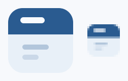
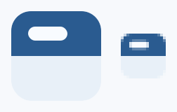
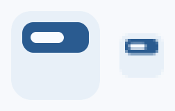
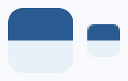
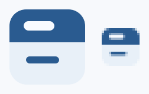
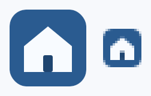
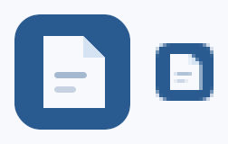

# Site icon

Status: Masthead is the direction. Four further versions sit under the original. The live favicon is unchanged.  
Scope: the main site mark in `website/templates/base.html` (`/icons/favicon.svg` and `/icons/favicon.ico`).  
Not in scope: section icons (Football, Feeds, Aircraft, and the rest) or the standalone webapp icons. Those hosts follow [Webapp-Design-Language.md](Webapp-Design-Language.md) and do not use this blue.

A letter **S** was drawn and rejected. It is not one of the options below.

## Brand

The mark has to look like the site people already see, and it has to survive a browser tab.

The site shell is a cool paper page and a blue header. Tokens live in `website/static/css/base.css`:

| Role | Colour |
| --- | --- |
| Header, left | `#2a5b90` (`--brand`) |
| Header, right | `#4d7bb1` (`--brand-soft`) |
| Deep blue | `#1f4570` (`--brand-strong`) |
| Type on the header | `#f8fbff` |
| Page | `#f7f9fc`, wash `#eef4ff` |
| Ink | `#182338` |

The header is a `0.95rem` rounded bar, gradient `132deg` from `#2a5b90` to `#4d7bb1`. Home calls itself **Website Dashboard**. The footer calls the place **Steve's Website**. The icon is the front door to that whole place, not a picture of one section.

The current favicon is a blue tile with three small blocks and a coral chip. The coral (`#ff9d6b` / `#ff6f61`) is not a site colour. At tab size the blocks merge, so the mark does not read as a dashboard or as this site.

Rules for whichever direction is chosen:

- One idea. Two or three shapes. Nothing that only exists to decorate.
- Stay inside the palette above. No second accent unless it is already a token.
- The 16px silhouette matters more than the 64px drawing. Inner lines that vanish at 16px are optional, not the idea.
- Rounded tile, in the same family as the header, not a sharp app icon and not the webapp green.

Each picture shows the mark at drawing size, and again at 16px beside it. The small one is enlarged with hard pixels so the tab result is visible.

## 1. Masthead

The icon is the header, shrunk: a paper square and a blue cap. The original is kept. The versions after it stay on that idea and only change how much of the header survives at 16px.

A gradient across the cap was tried. At tab size it flattens to the same blue as a flat fill, so it is not a separate option. A menu square in the cap was tried too. It reads as a window control, not as this site.

### 1.1 Original

A short blue cap, a thin white title, and two pale lines where the page content would be.

At 16px the title and both lines disappear. What remains is a blue band on a pale square. That is still the header, but only just.

### 1.2 Cap

The band is half the tile. The title is one thick white stroke, and the body lines are gone.

At 16px the white stroke stays a bar inside the blue. This is the original with the parts that vanished made heavy enough to keep.

### 1.3 Bar

On the real page the header is not glued to the top edge. It is a rounded blue bar sitting on the paper, with padding around it. This version is that.

At 16px the blue pill and the white title both remain. It is the closest to the header people already see. The risk is that a floating bar looks smaller, and less like an icon, than a cap that fills the top of the tile.

### 1.4 Split

No title and no lines. The top half is blue and the bottom half is paper.

This is the strongest silhouette. Nothing inside it can disappear. It is also the least specific: a two-tone square, not obviously a header, until you already know the site.

### 1.5 Rule

A shorter cap than Cap, a thick title, and one heavy line where the page content starts.

At 16px the title and the content line both survive, so it still reads as a header over a page. It is one more shape than Cap. The line has to stay this heavy or it vanishes the way the original lines did.

## 2. Window

One card, not three. Brand blue field, paper panel, a `--brand-soft` title bar. Same story as the current icon, with the parts that cannot be seen at 16px removed.

At 16px the text lines go, and the blue frame, pale card, and blue title bar remain. That is enough to read as a window. Iteration would be the frame thickness, how tall the title bar is, and whether any inner line is worth keeping.

## 3. Door

The site is the front door to the other sections. A white house on the header blue, door in `--brand-strong`. No extra lines.

This is the clearest of the four at 16px. The roof, wall, and door all survive. The risk is that it reads as a generic home button, or as a house product, rather than as this site. Iteration would be the roof pitch, how much wall sits under the eaves, and whether the door is a cutout instead of a dark rectangle.

## 4. Sheet

A website as a page. Paper sheet on the header blue, folded corner in the pale surface colour. The two rules are only there at larger sizes.

At 16px the rules vanish and the folded corner remains, so it still reads as a document. It is a familiar file icon. Iteration would be the fold size, the page margin inside the tile, and whether the sheet should be the whole icon with no blue field behind it.

## Choosing

Reply with **Original**, **Cap**, **Bar**, **Split**, or **Rule**. The next pass stays on that Masthead and tunes weight and proportion. Window, Door, and Sheet stay in this document and are not the next step.
