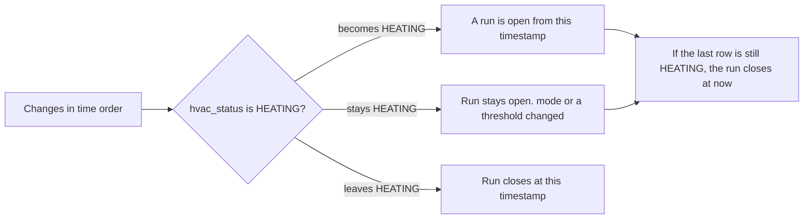

# Heating changes on the Monitor charts

This note is the contract for the heating read and the wash. The Stats button and its dialog stay; the dialog body is `design/Monitor-Heating-Time.md`. The half-interval run rule in `design/Monitor-Heating-Stats.md` is withdrawn. This note does not otherwise depend on that file.

## Goal

Read the heating change log and paint a red wash behind the temperature line for the times the heating is actually running. Keep the temperature line, the previous-period line, and the Daily / Weekly windows. The Stats button stays; what it opens is specified in `design/Monitor-Heating-Time.md`.

The current page can keep reading `web_database.heating_samples`. That collection stays in place and keeps receiving a heartbeat on every Nest poll. Switch this page to `web_database.heating_changes` when this note is implemented. Until that switch, leave the current reader alone.

`heating_changes` is one row each time the thermostat changes. Until the next row, those values are still in force. The page does not see a sample every minute, and it must not invent one. There is no sample interval and no gap rule. A gap check would cut a real run short, because a steady `HEATING` at steady thresholds writes no further row.

| Field | Meaning |
| --- | --- |
| `hvac_status` | Whether the equipment is actively heating or cooling. The wash follows `HEATING` only |
| `mode` | Whether the equipment will call for heat or cool against its thresholds |
| `heat_celsius` | The heat threshold, in degrees Celsius |
| `cool_celsius` | The cool threshold, in degrees Celsius |

The chart paints `hvac_status == HEATING`. A row that only moves `mode`, `heat_celsius`, or `cool_celsius` does not start or stop the wash. `COOLING` is kept on the row and is not drawn. Mode and both thresholds stay on the payload. A later usage page reads the same fields.

There is one thermostat. Draw that one timeline on every room chart. When “Previous period” is on, the amber temperature line is the previous window and the wash stays on this period’s heating only.

The Stats button stays on this page and opens the heating-time dialog. That dialog uses the same `HEATING` runs as the wash. It does not keep a second definition based on heartbeats. Its windows are calendar ranges, specified in `design/Monitor-Heating-Time.md`, not the chart’s rolling window.

## Stored documents

Database `web_database`, collection `heating_changes`. The unique index is `{ device_name: 1, timestamp: -1 }`.

```json
{
  "device_name": "Living Room Nest",
  "timestamp": { "$date": "2026-10-24T14:40:00.000Z" },
  "hvac_status": "COOLING",
  "mode": "HEATCOOL",
  "heat_celsius": 18.0,
  "cool_celsius": 23.0
}
```

| Field | Rule |
| --- | --- |
| `device_name` | Nest display name. This house has one thermostat |
| `timestamp` | UTC time when this combination was first observed |
| `hvac_status` | `OFF`, `HEATING`, or `COOLING` |
| `mode` | Nest mode, such as `HEAT`, `COOL`, `HEATCOOL`, or `OFF`. Omitted when that poll had none |
| `heat_celsius` | Heat threshold. Omitted when Nest did not send `heatCelsius` |
| `cool_celsius` | Cool threshold. Omitted when Nest did not send `coolCelsius` |

A `HEAT` poll carries `heat_celsius` and omits `cool_celsius`. A `COOL` poll carries `cool_celsius` and omits `heat_celsius`. `HEATCOOL` carries both. A missing threshold is not `0`.

Do not read `heating_samples` for this wash or for the Stats dialog. Those rows are heartbeats, including repeats of an unchanged thermostat. This reader uses `heating_changes` only. The poller may keep writing `heating_samples`. This page stops binding that collection.

## Payload

`GET /tools/monitor/timeseries` gains a sibling of `data`. The handlers are mounted at `/tools/monitor/timeseries` and `/tools/monitor/latest_data`. The page script requests `/timeseries/` and `/latest_data/` every 5 seconds. A page that ignores unknown keys keeps drawing temperature. The Stats dialog treats a missing `heating` object as no readings.

```json
{
  "data": [
    {
      "device_id": "hall",
      "data": [{ "timestamp": "2026-10-24T17:05:00+00:00", "temp": 19.4, "humidity": 48.0 }]
    }
  ],
  "heating": {
    "device_name": "Living Room Nest",
    "device_id": "living-room-nest",
    "changes": [
      {
        "timestamp": "2026-10-24T12:00:00+00:00",
        "hvac_status": "HEATING",
        "mode": "HEAT",
        "heat_celsius": 20.0
      },
      {
        "timestamp": "2026-10-24T12:10:00+00:00",
        "hvac_status": "HEATING",
        "mode": "HEAT",
        "heat_celsius": 21.0
      },
      {
        "timestamp": "2026-10-24T12:20:00+00:00",
        "hvac_status": "OFF",
        "mode": "HEAT",
        "heat_celsius": 21.0
      },
      {
        "timestamp": "2026-10-24T14:30:00+00:00",
        "hvac_status": "COOLING",
        "mode": "HEATCOOL",
        "heat_celsius": 18.0,
        "cool_celsius": 24.0
      },
      {
        "timestamp": "2026-10-24T14:40:00+00:00",
        "hvac_status": "COOLING",
        "mode": "HEATCOOL",
        "heat_celsius": 18.0,
        "cool_celsius": 23.0
      },
      {
        "timestamp": "2026-10-24T14:45:00+00:00",
        "hvac_status": "OFF",
        "mode": "HEATCOOL",
        "heat_celsius": 18.0,
        "cool_celsius": 23.0
      }
    ]
  }
}
```

| Field | Meaning |
| --- | --- |
| `device_name` | `device_name` from the stored row |
| `device_id` | `device_name.lower().replace(" ", "-")`, the same slug as a temperature series |
| `changes[].timestamp` | ISO 8601 UTC |
| `changes[].hvac_status` | `OFF`, `HEATING`, or `COOLING` |
| `changes[].mode` | Omitted when the stored row has none |
| `changes[].heat_celsius` | Omitted when the stored row has none |
| `changes[].cool_celsius` | Omitted when the stored row has none |

There is no `sample_interval_secs` and no `samples` array. `HeatingSeries` carries `device_name`, `device_id`, and `changes`. Drop `HEATING_SAMPLE_INTERVAL_SECS`.

`since` is the expression the timeseries handler already uses for temperature, `datetime.now() - timedelta(days=14)`. That clock is naive and the stored timestamps are UTC. Keep the existing expression.

The rows with `timestamp >= since` choose the thermostat. The prior row is the newest row before `since` for that same `device_name`. A name that appears only before `since` is not a second thermostat, and it is not read.

- More than one `device_name` in the window rows: omit `heating`. Mixing two live thermostats on one timeline is out of scope.
- Exactly one `device_name`: `changes` is those rows, plus that device’s newest row with `timestamp < since` when one exists. The extra row is the reading already in force at the start of the 14 days. Without it, a run that began earlier has no start, and the chart cannot tell unknown from off.
- No rows in the window: the log has been steady for 14 days. If the collection has exactly one `device_name`, `changes` is that device’s newest row. If it has more than one `device_name`, or no rows at all, omit `heating`.

The temperature array is unchanged either way. Do not fall back to the thermostat with the newest sample. The current `build_heating_series` helper does that, and this reader does not.

```python
since = datetime.now() - timedelta(days=14)
window = await heating_changes.find(
    {"timestamp": {"$gte": since}}
).sort("timestamp", 1).to_list(None)

names = {row["device_name"] for row in window}
if len(names) > 1:
    return None
if len(names) == 1:
    device_name = next(iter(names))
    prior = await heating_changes.find_one(
        {"device_name": device_name, "timestamp": {"$lt": since}},
        sort=[("timestamp", -1)],
    )
    changes = window
    if prior is not None:
        changes.insert(0, prior)
else:
    newest = await heating_changes.find_one(sort=[("timestamp", -1)])
    if newest is None:
        return None
    other = await heating_changes.find_one(
        {"device_name": {"$ne": newest["device_name"]}}
    )
    if other is not None:
        return None
    changes = [newest]
```

The timeseries handler is already async. Keep that. `heating_changes` is the Motor collection bound in `website/tools/monitor/__init__.py`. Await the cursor the same way `_load_heating_series` awaits `heating_samples` today. Do not call a synchronous `list(...)` on the collection inside the route.

Sort `changes` by timestamp ascending before responding. Pass the four heating fields through. Do not replace a missing threshold with `0`. The route already sets `response_model_exclude_none=True`. Keep it, so an absent mode or threshold is left off the JSON.

## Windows

`getPeriodBounds(period, periodOffset)` is the chart window. Daily is the rolling 24 hours ending now. Weekly is the rolling 7 days ending now. Offset `1` is the equal span immediately before that. The chart windows are not calendar days and not midnight-aligned. The Stats dialog uses local midnights instead, in `getHeatingStatsBounds`.

Temperature points inside a window are `timestamp >= start && timestamp < end`. Build heating runs from every change, then clip each finished run to that same inclusive start and exclusive end.

Do not drop changes outside the window before the walk. A row before the window is the status already in force. Filtering `changes` the way temperature points are filtered would drop the 12:00 row and hide a run that is already on when the window opens at 12:10.

## Turning changes into runs



1. Sort by timestamp. Walk every change, including rows before the window.
2. `hvac_status == HEATING` opens a run when the previous in-force status was not `HEATING`.
3. A later row that is still `HEATING` leaves that run open. Its `mode`, `heat_celsius`, and `cool_celsius` are the setting from that timestamp onward. It does not start a second rectangle.
4. A later row whose `hvac_status` is anything else, including `OFF` and `COOLING`, closes the heating run at that timestamp. The `COOLING` row stays in `changes`.
5. If the last row is `HEATING`, the run stays open through the end of the window being clipped. On the current window that end is now. On the previous window that end is in the past. If the last row is not `HEATING`, the run does not extend.
6. Clip to the window: start inclusive, end exclusive.

The morning rows are one heating run, 12:00–12:20. The 12:10 row changes the heat threshold from 20.0 to 21.0 and the wash continues. The afternoon rows stay in the payload: cooling runs from 14:30 to 14:45, and the 14:40 row only moves `cool_celsius`. That stretch is not a red wash. A window that opens at 12:10 still starts the wash at 12:10, because the 12:00 row is in the payload and the status in force at 12:10 is `HEATING`.

Extend an open run to now only while clipping a window that already ends at now. The previous window ends in the past. A run still `HEATING` at that end is clipped there.

Do not pass these rows through `smoothTemperatureSeries` or `alignPreviousPeriodData`. Smoothing would average a status. The previous-period shift would paint an older run on today’s clock. While drawing the wash, ignore `mode`, `heat_celsius`, and `cool_celsius`.

The Stats dialog uses this same function, with calendar-day bounds rather than `getPeriodBounds`. `heatingRuns` today pads each run by half of `sample_interval_secs` and splits a run when the gap is longer than two intervals. Delete that padding and that split. A steady `HEATING` with no further row is one run.

## How to draw it

Each room chart is one SVG, `chart-{device_id}` in `website/templates/tools/monitor/monitor.html`. `device_id` is `device_name.lower().replace(" ", "-")`. Humidity is a number beside the chart, not a line. The plot maps time across and degrees up, with 30px horizontal padding and 40px vertical padding. Y limits are `floor(min)` and `ceil(max)` of the current temperature line and the overlay line together.

The current temperature line is class `temperature temperature-current` (green `#0f8f7a`, dark `#2dceb2`). The previous-period line is class `temperature-overlay` (amber `#b56a12`, dark `#e0a24a`). The wash sits behind both lines.

In both `drawChart` and `updateChart`, after `drawGrid` and before `drawTemperature`:

1. Remove `#heating-bands-{device_id}` if it exists. `{device_id}` here is the room chart id.
2. If `heating` is missing or `changes` is empty, draw nothing.
3. Build runs with the rule above, clipped to `getPeriodBounds(chartPeriod, 0)`. Paint that one timeline on every room chart.
4. Append `<g class="heating-bands" id="heating-bands-{device_id}">` with one `<rect class="heating-band">` per clipped run. Map x through the same matrix as the polyline. Y spans the plot from `minTemp` to `maxTemp`. Clip to that rectangle so the wash does not cover the degree labels.
5. `pointer-events: none`. A `<title>Heating running</title>` on the group is the accessible name. Scrubbing keeps using polyline points.

Rebuild the group in both functions. A later grid append covers the wash, and a second update duplicates it, unless the old group is removed first.

```css
.chart-svg .heating-band {
  fill: var(--heating-band);
  stroke: none;
}
```

| Theme | Token | Value |
| --- | --- | --- |
| Light | `--heating-band` | `rgba(180, 35, 24, 0.23)` |
| Dark | `--heating-band` | `rgba(255, 122, 110, 0.31)` |

Set the token on `:root` and `body.dark-mode` in `website/static/css/tools/monitor/monitor.css`. Light danger in the site tokens is `#b42318` and dark danger is `#ff7a6e`. The wash uses those hues at the opacities in the table. The softer danger tint used by the Offline pill is too faint on the plot. Those values are already in the stylesheet. Change the file only if a value differs.

Leave the toolbar alone. Temperature is not optional, and the wash is not a third checkbox next to “Previous period” and “Smoothed”. “Smoothed” changes the temperature line only. A smoothed line can rise before a band or lag it, because the average is 45 minutes on Daily and 3 hours on Weekly. “Previous period” draws the amber temperature line and leaves the wash on this period’s runs.

Do not write “Heating” into `#status-{device_id}`. That node is online or offline.

Until `heating_changes` has rows, omit `heating`. The chart then matches a temperature-only page, and the Stats dialog says “No heating readings”. Do not draw a band for unknown, and do not fall back to `heating_samples` inside this reader.

## Stats dialog

The run list this section describes is withdrawn. The Stats button opens the dialog in `design/Monitor-Heating-Time.md` (Day, Week, and Month bars, a running total, and a month heatmap). Keep the button and the `<dialog>`. The run rule below is unchanged: those charts clip the same `HEATING` runs. `formatHeatingDuration` stays for pointer text.

`heatingSeriesIsUsable` is true when `heating` is present and `changes` is a non-empty array. It does not look for `samples` or `sample_interval_secs`.

Window shape, Previous, the pager, and empty copy are in `design/Monitor-Heating-Time.md`. A trailing `HEATING` still extends to now only on a window that contains now, and stops at the end of a window that does not. A month plus the previous month does not fit the 14-day chart payload; that dialog queries `heating_changes` for the span it shows.

## Later usage totals

A usage page is not part of this change. The Stats dialog is the page that shows these totals now. When a usage page is built, heating duration is the sum of the same clipped `HEATING` runs, not a count of rows and not a measurement of the rectangles. `mode`, `heat_celsius`, and `cool_celsius` on each row are the call setting and the thresholds from that timestamp until the next row. `COOLING` rows are available for a later cooling total. They are not added to the heating duration.

- Current window: the Stats dialog’s calendar span, with a trailing `HEATING` extended to now. The chart wash stays on `getPeriodBounds(period, 0)`.
- Previous window: the calendar span immediately before. A trailing `HEATING` stops at that midnight.

A range wider than 14 days needs its own query against `heating_changes`. Use the same read: rows from `since`, the device chosen from those rows, plus that device’s one row before `since`. The chart payload is the shared read for the horizons the charts already have.

## Where to edit

| File | Edit |
| --- | --- |
| `website/tools/monitor/__init__.py` | Bind `heating_changes`. Remove `heating_samples_collection`. The heartbeat collection stays in the database for the poller |
| `website/tools/monitor/models.py` | Optional `heating` on the timeseries response: `device_name`, `device_id`, and `changes` of `timestamp`, `hvac_status`, `mode`, `heat_celsius`, and `cool_celsius`. No `samples` and no `sample_interval_secs` |
| `website/tools/monitor/router.py` | Async load of `heating_changes` with the device rule and prior row above. Stop reading `heating_samples` |
| `website/static/js/tools/monitor/monitor.js` | Build `HEATING` runs from `heating.changes` for the band group in `drawChart` and `updateChart`, and for the Stats dialog. Bump `serviceWorkerPath` |
| `website/templates/tools/monitor/monitor.html` | Bump the `monitor.js` query on the script tag |
| `website/static/sw.js` | Same `monitor.js` query in the precache list. Set `TOOLS_CACHE_VERSION` to the same name as `serviceWorkerPath` |
| `website/static/tools/monitor/sw.js` | Same `monitor.js` query, and bump `MONITOR_CACHE_VERSION`, so this precache list matches |
| `website/static/css/tools/monitor/monitor.css` | `--heating-band` and `.heating-band`, only if a value differs |
| `website/tests/test_monitor_heating.py` | Assert `changes`, the same-device prior row, and omit-on-two-names. Drop `sample_interval_secs` and “newest thermostat wins” |

The page registers `/sw.js` from `serviceWorkerPath` in `monitor.js`. That file is `website/static/sw.js`. The script tag and the precache list currently name `/js/tools/monitor/monitor.js?v2.0.7`. `serviceWorkerPath` is `/sw.js?v=tools-webapp-v16` and `TOOLS_CACHE_VERSION` is `tools-webapp-v17`.

Raise the script query in the template and in both precache lists together, from `v2.0.7` to `v2.0.8`. Set `serviceWorkerPath` and `TOOLS_CACHE_VERSION` to the same new name, `tools-webapp-v18`. Raise `MONITOR_CACHE_VERSION` from `monitor-webapp-v8` to `monitor-webapp-v9`. An installed worker otherwise keeps the script that still reads `heating.samples`, fetches the new payload, and draws no wash. The service worker already fetches `/timeseries/` from the network. The new object rides that response.

Bump `/css/tools/monitor/monitor.css?v2.0.6` in the template and both precache lists only if that file changes.

The existing heartbeat reader is the code this change replaces, including the Stats dialog’s use of `heating.samples` and `sample_interval_secs`.

## Decisions

1. **Read `web_database.heating_changes`.** Bind it in the monitor package. Leave `heating_samples` in the database for the poller, and stop reading it from this page.
2. **`heating.changes` is the series.** Each item carries `timestamp`, `hvac_status`, `mode`, `heat_celsius`, and `cool_celsius`. There is no `samples` array and no sample interval. The wash and the Stats dialog both read `changes`.
3. **The window rows choose the device.** The prior row is the newest row before the 14-day horizon for that same `device_name`. A name that appears only before the horizon is not a second thermostat. If the window is empty and the collection has exactly one device, that device’s newest row is the series.
4. **A wash runs from a transition into `HEATING` until a transition out of it.** A later row that is still `HEATING` only updates `mode` or a threshold. `COOLING` stays on the row and is not drawn. The last `HEATING` extends to now on the current window only. Walk every change, then clip. Do not pad by half an interval or split on a gap.
5. **Draw this period’s runs on every room chart.** Previous-period heating stays in the payload and is not drawn. The Stats dialog totals the previous calendar span.
6. **Omit `heating` when there is no row, when the window has more than one `device_name`, or when the window is empty and the collection has more than one `device_name`.** The chart then matches a temperature-only page, and the dialog says “No heating readings”.
7. **The Stats button stays.** It opens the dialog in `design/Monitor-Heating-Time.md`. The run list is withdrawn. The half-interval rule in `design/Monitor-Heating-Stats.md` is withdrawn.
8. **Bump the cached `monitor.js` URL and the service-worker cache name in the same change.**

## Revision

This pass closes the gaps found when the note was checked against the current Monitor page.

- The Stats dialog stays in this change. It reads `heating.changes` and the same clipped runs as the wash. A separate usage page is still out of scope. The half-interval and gap rules in `design/Monitor-Heating-Stats.md` are withdrawn so the dialog and the stripes share one definition.
- The prior row is limited to the `device_name` chosen from the 14-day window. A retired thermostat’s last row no longer makes the payload look like two devices. A log with no row inside the window and exactly one device still contributes that newest row, so a steady run keeps its start.
- The query example is the async Motor shape the router already uses.
- The run steps say to walk every change and clip afterwards, so a row before the window is not filtered out with the temperature points.
- The file list adds `__init__.py`, the Stats dialog in `monitor.js`, the script query in the template, both service-worker precache lists, and `website/tests/test_monitor_heating.py`. The cache bump is `monitor.js?v2.0.8`, `tools-webapp-v18` for the page worker, and `monitor-webapp-v9` for the monitor worker list.
